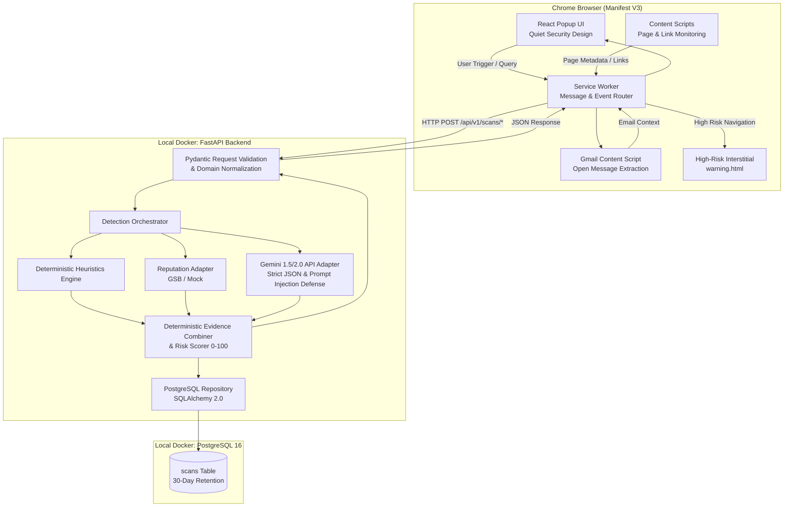

# Project Context — Phishing Attack Detector

## 1. Executive Summary

**Project Name:** Phishing Attack Detector (LLM-Based Phishing Detection Browser Extension)
**Timeline:** 15 Days
**Team:** Sarthak (Person 1) & Rohan (Person 2)
**Target Environment:** Windows, Google Chrome (Manifest V3), Local Docker Deployment (FastAPI + PostgreSQL 16)
**Primary Objective:** Deliver an explainable, testable, privacy-conscious academic prototype that detects potentially phishing websites and Gmail messages, explains findings with concise structured evidence, provides an explicit proceed/cancel confirmation on high-risk links, and measures detection metrics against a public dataset.

---

## 2. Source of Truth Documents

The project is governed by seven core foundational documents located in the repository root:
1. `Phishing_Detection_PRD_Antigravity.md`: Product goals, success criteria, detection agent guardrails, 15-day timeline, and team ownership.
2. `Phishing_Detection_TRD_Antigravity.md`: Technical stack, architecture, Pydantic schemas, database requirements, testing strategy, and acceptance criteria.
3. `Phishing_Detection_UI_UX_Design_Brief.md`: "Quiet Security" editorial visual tokens, component states, progressive disclosure, copy guidelines, accessibility (WCAG AA), and dark mode.
4. `Phishing_Detection_App_Flow.md`: Detailed user journeys (Manual Website Scan, Automatic Navigation Check, Gmail Message Scan, High-Risk Interstitial), feasibility gates, and error matrices.
5. `Phishing_Detection_Backend_Schema_Spec.md`: PostgreSQL 16 schema specification, domain normalization rules, privacy constraints, JSONB evidence structure, 30-day retention, and clear-history endpoint.
6. `Phishing_Detection_Implementation_Plan_Sarthak.md`: Daily plan and component deliverables for Sarthak (Agent, Heuristics, Gemini Adapter, PostgreSQL, Docker, Popup UI).
7. `Phishing_Detection_Project_Task_Division_Sarthak_Rohan.docx`: Responsibility matrix, shared integration responsibilities, and evaluation ownership.

---

## 3. Product Vision & Principles ("Quiet Security")

1. **Evidence Before Theatrics:** Lead with classification, risk score (0–100), and strongest concrete signals. No animated AI glow, terminal theatrics, fake scanning rings, speedometer gauges, or gradient clutter.
2. **Failure is Not Safety:** A provider timeout, quota exhaustion, API failure, or DOM extraction issue must be explicitly labeled `partial` or `unavailable` with slate styling—NEVER mapped to a clean/safe verdict.
3. **Risk Indicator, Not Probability:** The 0–100 score is a heuristic risk indicator. Never display it as a "% chance of phishing" or claim calibrated probability.
4. **Proportionate Interruption:** Intrusive warnings (interstitial) are reserved strictly for high-risk outcomes supported by evidence. Suspicious or uncertain cases remain advisory in the popup or panel.
5. **Privacy by Default:** Scans process only the active tab or user-selected Gmail message. Never store full email bodies, webpage HTML, passwords, form tokens, or sensitive query parameters. In PostgreSQL, `target_reference` stores normalized domain/hostname only.
6. **Explicit User Agency:** On high-risk destinations, provide an unmistakable "Go back to safety" (primary) and an explicit, quieter "Continue anyway" override. No auto-continue countdowns.

---

## 4. Reconciled Contradictions Across Project Documents

During analysis of the source documents, several discrepancies were identified. The following table records each contradiction and the reconciled decision:

| # | Topic | Document Discrepancy | Reconciled Decision (Source of Truth) |
|---|---|---|---|
| **1** | **Classification vs Unavailable Status** | PRD (7.5) and TRD (6.4) define classification enum strictly as `phishing`, `suspicious`, `likely_legitimate`, but Schema Spec (Sec 4 & 9) notes that for `analysis_status = unavailable`, a non-null classification creates confusion. | **Classification is Nullable:** When `analysis_status == 'unavailable'`, `classification` is `NULL` (or omitted) and `risk_score` is `NULL`. When status is `complete` or `partial`, `classification` is strictly one of `phishing`, `suspicious`, `likely_legitimate`. The UI relies on `analysis_status` as the ultimate authority. |
| **2** | **Target Reference Storage** | PRD (7.5, 10.1) suggests storing "normalized URL/domain... redact sensitive query values", whereas Schema Spec (Sec 1, 3) strictly mandates storing **lowercase hostname/domain only** (no scheme, path, query, fragment). | **Store Domain/Hostname Only:** In `scans.target_reference`, store only the normalized domain/hostname (e.g., `login.example.com`). Paths and query parameters are stripped before DB persistence. Full URLs remain in-memory only during transient scan execution. |
| **3** | **Response Schema: Signals vs Tool Statuses vs Evidence** | PRD uses `signals` & `reasons` (string list). TRD uses `signals` with string values (`complete`/`unavailable`). Schema Spec defines structured `evidence` (JSONB array of objects) and `tool_statuses` (JSONB object with status + reason_code). | **Unified Schema:** The API response provides: • `reasons`: `List[str]` (concise plain-language strings for immediate UI display) • `evidence`: `List[EvidenceItem]` (structured objects with `type`, `source`, `severity`, `explanation`) • `tool_statuses`: `ToolStatuses` (nested object detailing `heuristics`, `reputation`, `llm` with `status` and optional `reason_code`). |
| **4** | **Clear History Endpoint** | PRD mentions retention strategy; TRD omits delete endpoint from Table 6.1; Schema Spec explicitly defines `DELETE /api/v1/scans`. | **Include `DELETE /api/v1/scans`:** The endpoint is implemented for the local prototype, protected by CORS and local-origin constraints, requiring explicit user confirmation in the UI. |
| **5** | **Navigation Interception Mechanism** | PRD/Task Division suggest blocking high-risk navigation before proceed. TRD (Sec 9.2, 11) notes Manifest V3 restrictions make synchronous pre-navigation blocking unreliable without dedicated spikes. | **Two-Tier Warning Strategy:** 1. In-page warning banner / popup on detected high-risk page. 2. For link clicks on monitored pages, a content script click-interceptor routes high-risk targets to an extension warning page (`warning.html?target=...`). If browser-level blocking proves infeasible in the Day 2–3 spike, the content-script interceptor + warning page serves as the verified mechanism. |
| **6** | **Scan Source Enumeration** | Schema Spec defines `extension`, `gmail`, `manual`, `system`. TRD defines `manual`, `navigation`, `gmail`. | **Standardized Source Enum:** `manual_website`, `auto_website`, `gmail`. |

---

## 5. Open Technical Decisions & Required Spikes (Days 2–3 Gate)

1. **Reputation Provider Selection:**
   - *Option A:* Google Safe Browsing Lookup API v4 (Requires GCP Project & API Key; 10k req/day free).
   - *Option B:* VirusTotal API v3 (Strict rate limit: 4 req/min, 500 req/day).
   - *Decision Strategy:* Implement an abstract `ReputationProvider` interface. Use a mock adapter for tests and local development; enable Google Safe Browsing if the API key is configured in `.env`.
2. **Gmail DOM Message Extraction Spike:**
   - Gmail dynamic rendering and obfuscated classnames can break selectors.
   - *Spike Check:* Rohan tests extracting `sender`, `subject`, bounded `body_text`, and `links` from an active Gmail tab using stable DOM patterns (`h2[data-thread-perm-id]`, `div[data-message-id]`, etc.).
   - *Fallback:* If inline injection is brittle, the Extension Popup extracts the open email from the active tab and renders results inside the popup.
3. **Database Retention Automation:**
   - 30-day retention query `DELETE FROM scans WHERE created_at < now() - INTERVAL '30 days'` must not run on every user request.
   - *Decision:* Execute via FastAPI application startup event and an asynchronous background task (e.g., once every 24 hours), plus an optional CLI/maintenance command.

---

## 6. System Architecture

---

## 7. Responsibilities Summary

- **Sarthak (Person 1):** Extension React Popup UI, Detection Orchestrator, Deterministic Heuristics, Gemini API Adapter, Evidence Combiner & Risk Scorer, PostgreSQL Schema & SQLAlchemy Repository, Docker Compose, CI/Test Automation.
- **Rohan (Person 2):** FastAPI application setup, Pydantic Schemas & Validation, Website Content Scripts & Navigation Monitoring, Gmail Message Extraction & Inline UI, High-Risk Interstitial Warning (`warning.html`), Public Dataset Evaluation Pipeline, API Docs & README.
- **Shared:** Day 1–2 API Contract Lock, Day 5 End-to-End Slice Verification, Days 9–10 Cross-Integration, Concurrency & Failure Injection Testing, Day 14 Rehearsal, Day 15 Final Verification.
