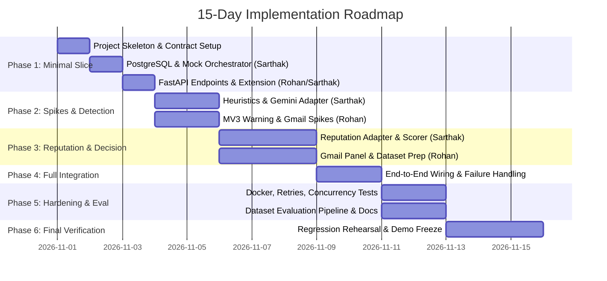

# Phased Implementation Roadmap — Phishing Attack Detector

**Project Timeline:** 15 Days (6 Distinct Implementation Phases)
**Primary Execution Strategy:** Vertical Slice First (Extension ↔ FastAPI ↔ Mocked Orchestrator ↔ PostgreSQL), then layer real heuristics, Gemini adapter, reputation adapter, browser integration, evaluation, and hardening.

---

## Roadmap Overview

---

## Phase 1: Project Skeleton & Minimal End-to-End Vertical Slice (Days 1–3)

### Goal
Establish the unified project structure, lock the API contract, and build a functioning vertical slice: clicking "Scan current site" in the React Chrome extension sends a request to FastAPI, which persists a mock detection record in PostgreSQL and returns a structured response rendered in the popup.

### Work Breakdown
- **Sarthak (Person 1):**
  - Initialize root repository layout (`extension/`, `backend/`, `docker-compose.yml`, `.env.example`, `.gitignore`).
  - Implement PostgreSQL 16 schema (`scans` table, indexes) with SQLAlchemy 2.0 models and Alembic migrations.
  - Implement repository layer: `create_scan()`, `get_scan_by_id()`, `list_scans()`.
  - Implement initial `MockDetectionOrchestrator` returning the complete agreed response schema.
  - Set up local Docker Compose configuration (`postgres` container and `backend` container).
- **Rohan (Person 2):**
  - Implement FastAPI application skeleton (`main.py`, router setup `/api/v1`).
  - Implement Pydantic request/response schemas matching the agreed contract:
    - `POST /api/v1/scans/website`
    - `POST /api/v1/scans/email`
    - `GET /api/v1/health` & `GET /api/v1/health/ready`
    - `GET /api/v1/scans` & `GET /api/v1/scans/{scan_id}`
  - Implement CORS middleware for Chrome extension origin (`chrome-extension://*`) and local development origins.
  - Build initial React popup shell in `extension/` using the Quiet Security design tokens (`canvas`, `surface`, `teal`, `ink`, `border`) with a "Scan current site" button.

### Testing Criteria & Checkpoint
- **Unit/Integration Test:** `pytest backend/tests/test_api_slice.py` verifies:
  - `POST /api/v1/scans/website` accepts valid URL, rejects invalid URL with 400.
  - Scan result is stored in PostgreSQL and retrieved via `GET /api/v1/scans/{id}`.
- **Manual Verification:** Unpack extension in Chrome, click popup "Scan current site", verify mock result renders with classification, risk score, and evidence.

---

## Phase 2: Technical Feasibility Spikes & Detection Foundation (Days 4–5)

### Goal
Validate browser navigation interception and Gmail DOM extraction capabilities; implement the core deterministic heuristics engine and the Gemini API adapter with strict structured outputs.

### Work Breakdown
- **Sarthak (Person 1):**
  - Implement `DeterministicHeuristicsEngine` in `backend/app/detection/heuristics.py`:
    - IP hostname detector
    - Punycode / IDN lookalike detector
    - Misleading subdomain pattern detector
    - URL length and excessive special character detector
    - Credential keyword and urgency language detector
  - Implement `GeminiAdapter` in `backend/app/providers/gemini.py`:
    - Server-side API key configuration (`GEMINI_API_KEY`).
    - Bounded timeouts (5.0s) and single retry on 429/503.
    - Structured output JSON mode enforcing Pydantic output model.
    - System prompt treating scan text strictly as untrusted data (prompt injection defense).
- **Rohan (Person 2):**
  - **Spike 1: Navigation Warning Mechanism in Chrome MV3:**
    - Test content-script link interception vs `chrome.webNavigation.onBeforeNavigate`.
    - Build `warning.html` interstitial page with "Go back to safety" (history back) and "Continue anyway" (whitelist domain for session).
  - **Spike 2: Gmail Open Message Extraction:**
    - Prototype DOM selector extraction on active Gmail tab for open thread (`sender`, `subject`, bounded body text, link hrefs).
    - Determine failure boundary: if DOM changes, gracefully report extraction failure without crashing.

### Testing Criteria & Checkpoint
- **Heuristics Tests:** Unit tests validating known phishing URL patterns vs legitimate clean URLs.
- **Gemini Mock Tests:** Unit tests verifying valid JSON parsing, handling of malformed LLM responses, and timeout/quota fallback.
- **Spike Output:** Working proof-of-concept demonstrating warning interstitial on click and successful extraction of test Gmail email.

---

## Phase 3: Reputation Adapter, Decision Policy & Surface Expansion (Days 6–8)

### Goal
Integrate reputation service abstraction, deterministic evidence combination rules, 30-day retention cleanup, Gmail inline UI, and dataset acquisition.

### Work Breakdown
- **Sarthak (Person 1):**
  - Implement `ReputationAdapter` interface and `GoogleSafeBrowsingAdapter` (or `MockReputationAdapter` if no key provided).
  - Implement `EvidenceCombiner` (`backend/app/detection/combiner.py`):
    - Combine heuristics + reputation + Gemini outputs deterministically into final risk score (0–100) and classification (`phishing`, `suspicious`, `likely_legitimate`, or `unavailable`).
    - Explicitly calculate `analysis_status` (`complete`, `partial`, `unavailable`).
  - Implement daily 30-day retention cleanup routine and repository clear-history query.
- **Rohan (Person 2):**
  - Implement Gmail inline scan button and result panel based on Phase 2 DOM spike.
  - Implement high-risk warning interstitial UI using Quiet Security styling.
  - Acquire evaluation dataset: Public phishing URLs (PhishTank / Mendeley) and legitimate domains (Tranco top list). Create data loader script in `evaluation/scripts/load_dataset.py`.

### Testing Criteria & Checkpoint
- **Combiner Unit Tests:** Verify all score boundaries (0–39 legitimate, 40–74 suspicious, 75–100 phishing) and confirm that a missing provider NEVER yields a "likely legitimate" verdict.
- **Retention Test:** Verify that rows older than 30 days are purged while newer records are preserved.

---

## Phase 4: Full System Integration & Contract Alignment (Days 9–10)

### Goal
Connect all browser surfaces to the live detection backend; verify partial and unavailable error states; implement clear-history endpoint.

### Work Breakdown
- **Shared Collaboration (Sarthak & Rohan):**
  - Connect React popup to live detection pipeline (replacing Phase 1 mocks).
  - Connect Gmail content script to `POST /api/v1/scans/email`.
  - Connect high-risk link warnings to real detection results.
  - Implement `DELETE /api/v1/scans` for user history purge with UI confirmation.
  - Verify all error states in the UI:
    - Gemini quota exceeded → Result shows `partial` with heuristics-only score, slate note.
    - Reputation timeout → Marked `unavailable` in tool status, analysis completes with remaining signals.
    - Backend offline → Popup renders clear offline message with retry, no verdict.
    - Database offline → Explicit 503 error returned.

### Testing Criteria & Checkpoint
- End-to-end integration test: Scan legitimate website, scan phishing test fixture, scan Gmail test message.
- Verify that every surface complies with Quiet Security design tokens and accessibility guidelines.

---

## Phase 5: Hardening, Evaluation Pipeline & Docker Optimization (Days 11–12)

### Goal
Finalize production-grade containerization, execute dataset benchmark evaluation, run concurrency and failure tests.

### Work Breakdown
- **Sarthak (Person 1):**
  - Refine Docker Compose with production-ready health checks, resource bounds, and non-root user.
  - Implement structured logging with scan IDs and latency tracking; ensure no secrets, API keys, or raw email/webpage bodies are logged.
  - Write concurrency test (`backend/tests/test_concurrency.py`) testing 10 simultaneous scan requests.
  - Write failure-injection test suite (simulated DB crash, network timeouts).
- **Rohan (Person 2):**
  - Execute evaluation pipeline (`evaluation/scripts/evaluate.py`) across the 3 configurations:
    1. Heuristics-only
    2. Heuristics + Reputation
    3. Full pipeline (+ Gemini)
  - Generate evaluation report (`evaluation/reports/EVALUATION.md`) with Precision, Recall, F1 Score, False-Positive Rate, Confusion Matrix, and Latency.
  - Generate OpenAPI docs and complete user setup guide in `README.md`.

### Testing Criteria & Checkpoint
- Automated test suite passes 100% of unit, integration, concurrency, and failure tests.
- Benchmark evaluation completed with documented metrics and limitations clearly stated.

---

## Phase 6: Regression, Demo Rehearsal & Final Verification (Days 13–15)

### Goal
Freeze features, conduct comprehensive end-to-end rehearsals, verify clean checkout from scratch, and prepare presentation.

### Work Breakdown
- **Joint Responsibilities (Sarthak & Rohan):**
  - Full system regression testing on a clean machine/environment following `README.md` step-by-step.
  - Rehearse 5 core demo scenarios:
    1. Scan a legitimate site (e.g., `wikipedia.org`) → Shows `likely_legitimate` with low risk score and non-guarantee note.
    2. Scan a mock high-risk phishing site → Shows `phishing` warning, risk score, concrete reasons, and "Go back to safety" / "Continue anyway" choice.
    3. Scan an open Gmail message containing suspicious links → Shows inline email warning.
    4. Scan history and clear-history flow in the extension popup.
    5. Graceful degradation demo: Simulate Gemini quota exhaustion / backend unavailable → Shows clean `partial`/`unavailable` state without crashing or claiming safety.
  - Final scope freeze; fix only critical demo blockers.

---

## Milestone Deliverables Summary

| Milestone | Target Days | Key Deliverable | Owner |
|---|---|---|---|
| **M1: Vertical Slice** | Days 1–3 | Extension popup ↔ FastAPI ↔ Mock detection ↔ PostgreSQL | Sarthak & Rohan |
| **M2: Core Engines & Spikes** | Days 4–5 | Heuristics engine, Gemini adapter, MV3 warning spike, Gmail DOM spike | Sarthak (Det), Rohan (Browser) |
| **M3: Full Workflow** | Days 6–8 | Reputation adapter, combiner, 30-day retention, Gmail panel, dataset | Sarthak (Backend), Rohan (Ext/Data) |
| **M4: System Integration** | Days 9–10 | Live end-to-end website + email flows, partial/unavailable states | Shared |
| **M5: Eval & Hardening** | Days 11–12 | Evaluation report (Precision/Recall/F1), Docker hardening, concurrency tests | Sarthak (Ops/Tests), Rohan (Eval/Docs) |
| **M6: Final Freeze & Demo** | Days 13–15 | 5 rehearsed demo scenarios, passing test suite, final verification | Shared |
