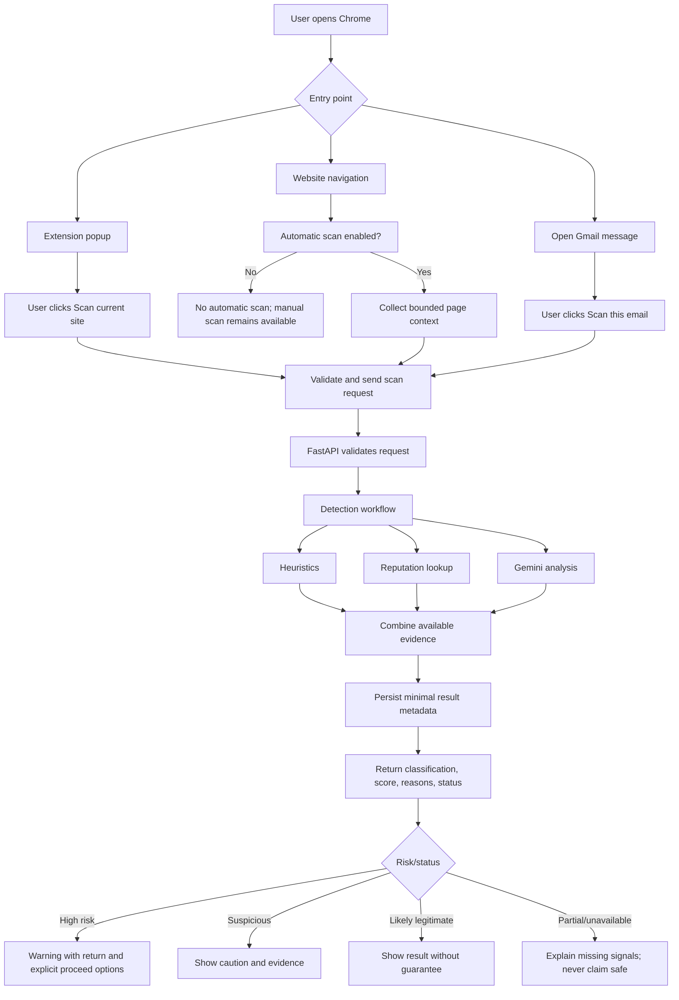

# App Flow Document
## LLM-Based Phishing Detection Browser Extension

**Version:** 1.0  
**Status:** Implementation-ready flow with feasibility items flagged  
**Project timeline:** 15 days  
**Deployment target:** Local laptop using Docker  
**Clients:** Chrome extension for websites + Gmail  
**Backend:** FastAPI + PostgreSQL + Gemini API + URL reputation adapter

---

## 1. Product Experience Principles

The extension should feel like a focused security utility, not a generic AI dashboard.

1. **Evidence before theatrics:** show the classification, risk score, and the few strongest reasons. Avoid animated AI effects, gradients, fake terminal visuals, and decorative charts.
2. **Warn proportionately:** interrupt only when the combined evidence crosses a defined high-risk threshold. Lower-confidence cases should be informative, not alarmist.
3. **Never confuse failure with safety:** unavailable providers, timeouts, or extraction failures must be shown as partial/unavailable analysis—not as “safe.”
4. **Make the next action obvious:** scan, review evidence, return to safety, or proceed after an explicit confirmation.
5. **Minimize collected data:** analyze the current page or open/selected email only. Persist minimal scan metadata and results, not full page/email content.
6. **Keep the product understandable:** use plain language and short evidence statements. Technical details may be available in a secondary “Why?” area.

## 2. Visual Direction and Colour Palette

### Design concept: “Quiet security”

Use a warm, neutral canvas, dark ink typography, restrained teal for normal actions, and amber/red only for meaningful risk states. No gradients, neon outlines, glassmorphism, glowing cards, or excessive pill badges.

> This palette is specified as design tokens for implementation. Use the same tokens in the popup, Gmail warning panel, and warning surface.

| Token | Hex | Usage |
|---|---|---|
| `canvas` | `#F7F5F0` | Main popup/page background; warm off-white |
| `surface` | `#FFFFFF` | Result panels and forms |
| `ink` | `#17212B` | Primary text and headings |
| `muted` | `#5F6B75` | Secondary text and metadata |
| `border` | `#D8DEE3` | Dividers, outlines, card boundaries |
| `teal` | `#0F766E` | Primary action, links, selected navigation |
| `teal-soft` | `#E5F3F0` | Subtle positive/neutral accent background |
| `amber` | `#9A5B00` | Suspicious state and caution |
| `amber-soft` | `#FFF1D6` | Suspicious warning background |
| `red` | `#B42318` | High-risk/phishing warning |
| `red-soft` | `#FDECEA` | High-risk warning background |
| `slate-soft` | `#EDF1F4` | Neutral information and unavailable states |
| `focus` | `#2563EB` | Keyboard focus ring |

### Colour rules

- **Phishing / high risk:** red text/icon with `red-soft` background; use a clear label, not colour alone.
- **Suspicious / uncertain:** amber text/icon with `amber-soft` background.
- **Likely legitimate:** neutral ink with a small teal accent. Do not use a large green “SAFE” badge.
- **Partial or unavailable analysis:** slate treatment and explicit status wording.
- **Primary action:** solid teal with white text. Secondary action: white surface with border.
- Maintain readable contrast and visible keyboard focus. Never encode status by colour alone; pair it with text and an icon.
- Avoid red/green-only comparisons and avoid showing risk score as a probability.

### Typography and layout

- Use the system UI font stack; avoid decorative display fonts.
- Popup width should fit a compact Chrome extension surface; use a single-column layout.
- Use an 8 px spacing rhythm, 8–12 px corner radii, and thin borders instead of heavy shadows.
- Use sentence case labels, concise copy, and consistent alignment.
- Reserve bold text for classification and the most important evidence.
- Avoid charts in the first release. A clearly labelled score and evidence list are sufficient.

---

## 3. Navigation Model

The extension has three main user-facing surfaces:

1. **Extension popup:** manual website scan, latest result, and recent scan summaries.
2. **Gmail inline panel:** scan the open/selected message and display the result close to the message.
3. **High-risk navigation warning:** an interstitial/confirmation surface when a supported navigation flow detects a high-risk destination.

Settings can remain minimal in the prototype:
- Automatic website scanning: on/off.
- Backend connection status.
- Optional “Clear scan history” action if history UI is implemented.
- No user account/login screen in the initial version.

## 4. Core Flow Overview

**Important:** the flow represents intended behavior. Automatic checks and pre-navigation interception must be implemented only through Chrome-supported APIs and verified in the target Chrome version. See Section 11.

## 5. Flow A — Manual Website Scan

### A1. User journey

1. User opens a website.
2. User clicks the extension icon.
3. Popup shows the current hostname and a **Scan this site** primary action.
4. User clicks **Scan this site**.
5. Extension collects the current URL, page title, and bounded visible text. It must not collect form values, passwords, cookies, or authentication tokens.
6. Service worker sends the request to the local FastAPI backend.
7. Backend validates the request and runs the detection workflow.
8. Extension shows the result or an explicit error/partial state.

### A2. Popup states

**Idle**
- Header: `Phishing check`
- Context: `Current site: example.com`
- Primary action: `Scan this site`
- Secondary information: `Analysis runs through your local backend.`

**Scanning**
- Show a restrained spinner and `Checking URL and page signals…`
- Disable duplicate submissions while the request is in progress.
- If the request exceeds the timeout, transition to an explicit timeout state.

**Result**
- Classification label.
- Risk score, e.g. `Risk score: 68/100` (not “68% chance”).
- Up to three strongest reasons, with an expandable section for additional evidence if useful.
- Status note: `Analysis complete` or `Some checks were unavailable`.
- Action: `Scan again`.

**Error / unavailable**
- Message example: `We couldn't complete the analysis because the local backend is unavailable.`
- Actions: `Retry` and `Check connection`.
- Do not display a green/positive result when the request failed.

### A3. Result copy examples

- **Phishing:** `High risk — several strong phishing indicators were found.`
- **Suspicious:** `Use caution — some signals need review.`
- **Likely legitimate:** `No strong phishing indicators were found. This is not a guarantee that the site is safe.`
- **Partial:** `Partial analysis — one or more checks could not run.`
- **Unavailable:** `No reliable result — analysis could not be completed.`

## 6. Flow B — Automatic Website Checks

### B1. Intended flow

1. User navigates to a supported website.
2. Extension checks whether automatic scanning is enabled.
3. If disabled, it does not initiate an automatic scan; manual scan remains available.
4. If enabled, the extension gathers the minimum permitted context and submits a scan request.
5. Backend evaluates the target.
6. Low-risk/no-strong-signal results do not interrupt the user.
7. Suspicious results may appear in the popup or as a restrained non-blocking notice.
8. High-risk results enter the warning flow only if the chosen interception mechanism is technically supported and reliable.
9. Duplicate warnings for the same destination should be suppressed for a short session window to reduce warning fatigue.

### B2. Automatic scanning constraints

- Automatic scanning must be configurable and documented.
- Avoid scanning every page repeatedly due to client-side navigation, reloads, or duplicate content-script events.
- Use a short debounce/deduplication strategy and explicit request limits.
- Do not send page content from unsupported or restricted browser pages.
- Do not block normal navigation solely because the backend is down.
- If analysis is unavailable, do not infer that the destination is safe.
- Initial implementation should prioritize correctness and a demonstrable flow over aggressive scanning of every navigation.

## 7. Flow C — High-Risk Link Warning / Interception

### C1. Intended interaction

1. A supported navigation/link flow identifies a destination that has a cached or newly computed high-risk result.
2. A warning surface appears before the user proceeds, where the Chrome API and navigation timing permit it.
3. The warning displays:
   - `Potential phishing site`
   - Destination hostname, safely escaped/truncated.
   - Risk score out of 100.
   - Two or three strongest reasons.
   - `Go back` as the primary safe action.
   - `Continue anyway` as a visually secondary action requiring an explicit click.
4. If the user chooses **Go back**, close the warning or return to the prior page using the supported browser mechanism.
5. If the user chooses **Continue anyway**, continue only through the implemented, verified navigation flow and record the user's override event only if that event is part of the documented metadata policy.

### C2. Safety behavior

- Never claim that every dangerous link is guaranteed to be blocked.
- Do not intercept browser-internal pages or unsupported schemes.
- Avoid recursive interception when opening the warning surface itself.
- Validate the destination URL and escape all displayed text.
- If the risk result is unavailable, do not invent a high-risk score. Show a normal unavailable state instead.
- A cached high-risk result can improve response time, but it must be tied to a normalized destination and have a defined expiry.
- The override action should be explicit; no auto-continue countdown.

### C3. Feasibility note

Chrome Manifest V3 has restrictions on blocking and redirecting navigation through extensions. The exact pre-navigation mechanism must be prototyped and verified early. A reliable fallback is to show an in-page or popup warning after detection and before the user manually opens the destination, but that is not equivalent to guaranteed browser-level interception.

## 8. Flow D — Gmail Message Scan

### D1. User journey

1. User opens Gmail and selects or opens a message.
2. An extension-provided **Scan this email** control/panel appears near the message, if Gmail's current DOM structure allows stable insertion.
3. User clicks the control.
4. Content script extracts only the currently open/selected message:
   - Sender
   - Subject
   - Bounded plain-text body
   - Capped list of links
5. Extension validates extracted fields and sends them to the local backend.
6. Backend runs the same detection workflow, with email-specific heuristics.
7. Result is displayed in the Gmail inline panel.
8. If high risk, the panel displays a clear warning and identifies suspicious links. Link interception is handled separately and must not be assumed to work merely because the email was classified as high risk.

### D2. Gmail panel states

**Ready**
- `Check this email`
- Helper text: `Only the open message is analyzed.`

**Scanning**
- `Checking sender, message language, and links…`

**High risk**
- Red-tinted panel.
- `Potential phishing email`
- Risk score and concise reasons.
- Link list with hostnames and safe-to-read destination details.
- Recommendation: `Do not enter credentials or open suspicious links.`

**Suspicious**
- Amber-tinted panel.
- `Review this email carefully`
- Evidence list and cautious recommendation.

**Likely legitimate**
- Neutral panel.
- `No strong phishing indicators were found.`
- Include the non-guarantee note.

**Extraction/API unavailable**
- `We couldn't analyze this message.`
- Do not show a safe state.
- Provide retry or explain that the message structure could not be read.

### D3. Gmail constraints

- Scan only the current/open or explicitly selected message; no mailbox-wide scanning.
- Never collect passwords, form values, cookies, or unrelated mailbox messages.
- Do not store the full email body in PostgreSQL by default.
- Gmail may change its DOM; selectors must be isolated and tested, and extraction failure must be visible.
- OAuth/Gmail API integration remains out of scope unless DOM extraction proves infeasible and the team explicitly revises scope.
- The inline panel must not obscure Gmail's primary controls or mimic Gmail's native security UI deceptively.

## 9. Shared Detection and Result Flow

### 9.1 Backend sequence

1. Receive request at `/api/v1/scans/website` or `/api/v1/scans/email`.
2. Validate schema, scheme, field lengths, and link count.
3. Normalize relevant values and create a request/scan identifier.
4. Run heuristics.
5. Call the configured reputation adapter if available and within its terms/quota.
6. Call Gemini with bounded, untrusted content and a strict expected schema.
7. Validate provider responses.
8. Combine evidence through deterministic, testable decision rules.
9. Store only metadata/results.
10. Return the result including tool status and analysis status.

### 9.2 Decision outcomes

| Outcome | UI treatment | Meaning |
|---|---|---|
| `phishing` | Red | Strong evidence of phishing; still not a guarantee |
| `suspicious` | Amber | Concerning or conflicting signals |
| `likely_legitimate` | Neutral/teal accent | No strong indicators found; not guaranteed safe |
| `analysis_status=partial` | Slate note alongside classification | Some checks failed or were unavailable |
| `analysis_status=unavailable` | Neutral error state | No reliable classification could be produced |

The classification and analysis status are separate. For example, a scan may be `suspicious` with `partial` analysis if the heuristic signal is concerning but a provider timed out.

### 9.3 Provider failures

- Gemini quota exceeded: do not retry indefinitely; return remaining usable evidence as partial, or unavailable if no reliable result exists.
- Reputation provider timeout/rate limit: mark only that signal unavailable and continue where possible.
- Local backend unavailable: extension shows a connection error; no classification is invented.
- Database unavailable: follow a documented degraded behavior. Do not claim the scan was saved. If analysis completed, either return a clearly marked unsaved result or an explicit error according to the agreed API contract.
- Malformed LLM response: reject the response, record a redacted provider error, and continue with other signals where possible.

## 10. Scan History and Privacy Flow

1. A scan completes.
2. Backend stores the scan ID, target type, minimized target reference, classification, risk score, concise reasons/signals, analysis status, and timestamp.
3. Full page HTML and full email body are not stored by default.
4. Recent history may show date/time, target hostname or non-sensitive reference, classification, and score.
5. If history is cleared, delete the stored rows associated with the user's local prototype as implemented.
6. Document the retention period and the exact data stored.

Because the initial prototype has no user account system, history is local to the shared development database, not isolated per person. Do not expose a publicly reachable backend without revisiting access controls and data isolation.

## 11. Technical Feasibility Risks and Required Spikes

These items must be tested early, not assumed to be solved.

| Risk / unknown | Why it matters | Required check | Fallback |
|---|---|---|---|
| Pre-navigation interception | MV3 APIs restrict blocking/redirecting; a scan may finish after navigation | Prototype on target Chrome version by Day 2–3 | Show warning before user opens a link when possible, or show a post-detection warning; document the limitation |
| Automatic navigation scanning | SPA navigation and repeated events can cause duplicates or delays | Test full-page and client-side navigation; measure request count | Debounced scanning and manual scan |
| Gmail inline injection | Gmail DOM changes and dynamic rendering may break selectors | Test on a real Gmail account with sample messages | Extension popup scan for the open message or a clearly documented extraction limitation |
| Gmail message extraction | Sender/body/link elements may not be consistently available | Validate extraction on several message formats, including plain text and HTML-rendered messages | Mark extraction partial/unavailable; do not classify as safe |
| Local backend reachability | Extension origin/CORS/host permissions and local HTTP behavior may cause failures | Verify Chrome extension → local FastAPI connectivity, CORS, and host permissions | Document one supported local URL and exact setup steps |
| Reputation API terms/quotas | Free tiers and acceptable-use terms can change | Verify before selecting and using provider | Make adapter optional and show provider unavailable |
| Gemini quota/outage | Free-tier limits may prevent analysis during demo | Test quota and error handling; keep key server-side | Heuristics/reputation partial result, or unavailable |
| Database outage | Persistence may fail after analysis | Test database stopped during a scan | Return explicit unsaved/degraded state or error per API contract |
| Warning fatigue | Too many warnings reduce user trust | Test repeated same-domain navigation | Deduplicate warnings and warn only above threshold |

### Day 2–3 feasibility gate

Do not invest heavily in polished warning UI until these are proven:
1. Extension can call the local FastAPI backend.
2. Manual website scan returns a real structured result.
3. Gmail can extract a single open message on the target Gmail interface.
4. The proposed warning mechanism can be demonstrated on the target Chrome version.

## 12. Error and Empty States

| Situation | User-facing message | Required behavior |
|---|---|---|
| Backend offline | `Can't connect to the local analysis service.` | Retry; never show a safe result |
| Request timeout | `The check took too long to finish.` | Bounded retry option |
| Gemini unavailable | `AI analysis is unavailable; other checks may still be available.` | Partial result if useful evidence remains |
| Reputation unavailable | `Reputation check unavailable.` | Continue with other signals |
| No page text accessible | `Only the URL could be checked.` | Clearly mark limited analysis |
| Gmail extraction failed | `We couldn't read this message for analysis.` | Retry or show unavailable |
| Invalid URL | `This URL can't be analyzed.` | Explain accepted schemes/format |
| Malformed provider output | `One analysis check returned an invalid response.` | Reject unsafe output and continue if possible |
| No result could be produced | `No reliable result is available right now.` | No classification presented as definitive |

## 13. Accessibility and Interaction Requirements

- All controls must be keyboard reachable.
- Focus must be visible using the focus token.
- Buttons must have clear accessible names.
- Status changes should be announced through appropriate accessible live regions.
- Pair risk colour with text and an icon.
- Ensure text contrast against all backgrounds.
- Avoid flashing, pulsing, countdowns, and motion that implies urgency without evidence.
- The “Continue anyway” control must be less visually prominent than “Go back” but remain readable and accessible.
- Hostnames and long URLs must wrap or truncate without hiding the domain's meaningful portion.

## 14. Analytics and Success Measures

Do not add invasive third-party analytics to the prototype. Use local logs and evaluation outputs.

Track operationally:
- Scan success/partial/unavailable counts.
- End-to-end latency and provider latency.
- Provider timeout/quota/failure counts.
- Classification distribution.
- Dataset precision, recall, F1, confusion matrix, and false-positive rate.

Do not log raw email bodies, page text, credentials, or API keys. Do not describe the risk score as a probability unless calibration has been measured and validated.

## 15. Screen and Component Inventory

| Surface | Component | Primary purpose |
|---|---|---|
| Extension popup | Header + current hostname | Orient user to target |
| Extension popup | `Scan this site` button | Start manual scan |
| Extension popup | Loading state | Show progress without duplicate submissions |
| Extension popup | Result summary | Classification and 0–100 score |
| Extension popup | Evidence list | Explain the strongest signals |
| Extension popup | Analysis status note | Explain partial/unavailable checks |
| Extension popup | Recent scans | Optional local history |
| Gmail | `Scan this email` action | Start message analysis |
| Gmail | Inline result panel | Show classification, score, and evidence |
| Warning surface | Destination summary | Identify the destination being opened |
| Warning surface | `Go back` action | Preferred safe action |
| Warning surface | `Continue anyway` action | Explicit user override |
| Settings (minimal) | Auto-scan toggle | Control automatic checks |
| Settings (minimal) | Backend status | Help troubleshoot local service |

## 16. Implementation Priorities

### P0 — Required for demo
- Manual website scan.
- FastAPI API contract and validation.
- Heuristics + Gemini adapter with explicit failure states.
- PostgreSQL metadata persistence.
- Clean popup result UI using the defined palette.
- Docker Compose local backend/database.
- Basic tests and reproducible setup instructions.

### P1 — Required if feasible within the schedule
- Gmail open-message extraction and inline panel.
- Automatic website checks with deduplication.
- Reputation provider integration.
- Recent scan history.

### P2 — Only after P0/P1 are stable
- Reliable high-risk navigation interception, if the early technical spike validates the chosen Chrome mechanism.
- Additional settings and deeper technical details.

If time becomes constrained, keep the manual website scan vertical slice reliable rather than shipping a misleading or fragile interception feature.

## 17. Definition of Done

The App Flow is considered implemented when:
- The manual website flow works from extension click to rendered result.
- Gmail scanning either works on the tested Gmail interface or shows a clear, tested limitation.
- Automatic checks can be toggled and do not produce uncontrolled duplicate requests.
- Risky results show concise evidence and an appropriate warning.
- Unavailable/partial states are visually distinct from a likely-legitimate result.
- High-risk navigation handling is demonstrated or explicitly documented as unsupported/limited.
- Minimal metadata is stored; full page/email content is not retained by default.
- The UI uses the same colour tokens consistently and remains readable without relying on colour alone.
- Tests cover the core flow and major provider/backend failure paths.
- The demo can be reproduced from a clean checkout using the README.

## 18. Instructions for Antigravity

1. Read the PRD, TRD, and this App Flow Document before implementing UI or navigation behavior.
2. Inspect the existing repository and preserve working code.
3. Implement the design tokens first; do not substitute generic gradients or a prebuilt dashboard aesthetic.
4. Build and verify the manual website vertical slice before automatic scanning or navigation interception.
5. Prototype the Chrome warning mechanism and Gmail extraction early; report actual browser limitations rather than faking behavior.
6. Keep page/email text untrusted, bounded, and out of persistent storage by default.
7. Use consistent request/response schemas and status enums across frontend and backend.
8. Add tests for every major state and failure path.
9. Do not claim a page is safe when analysis is partial or unavailable.
10. Keep the 15-day scope; document deferred features rather than silently adding scope.
