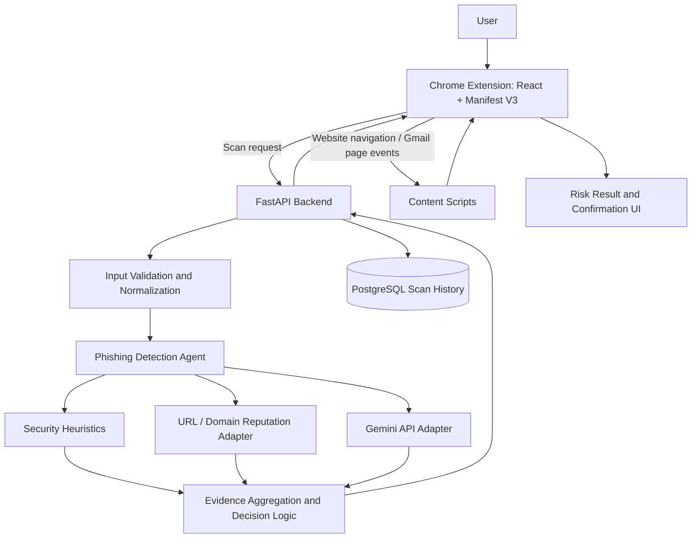

# Product Requirements Document (PRD)
## LLM-Based Phishing Detection Chrome Extension

**Document purpose:** Implementation brief for Antigravity  
**Project duration:** 15 days  
**Team:** Sarthak (Person 1) and Rohan (Person 2)  
**Target environment:** Windows, Chrome, local Docker deployment  
**Primary objective:** Deliver a working Chrome extension that detects potentially phishing websites and Gmail messages, explains its findings, and measures detection performance.

---

## 1. Product Vision

Build a Chrome extension that helps users recognize phishing websites and suspicious Gmail messages before they interact with risky links. The product combines deterministic security heuristics, a URL/domain reputation service, and the Gemini API to produce explainable risk assessments.

The extension must prioritize a reliable end-to-end working product over unnecessary complexity. It is an academic prototype, not a guarantee that a website or email is safe.

## 2. Goals and Success Criteria

### 2.1 Goals
- Scan the current website on user request.
- Monitor website navigation and warn only when strong risk indicators are detected.
- Allow users to scan a selected Gmail message.
- Show an understandable classification, risk score, and supporting evidence.
- Ask for explicit confirmation before proceeding to a link classified as high risk.
- Store minimal scan metadata and results in PostgreSQL.
- Evaluate detection performance on a public phishing dataset plus legitimate examples.
- Run locally using Docker and provide repeatable setup instructions.

### 2.2 Success criteria
- A user can trigger a website scan and receive a result in the extension UI.
- A selected Gmail message can be analyzed and the result shown within Gmail or the extension UI.
- Strong-risk links trigger a warning and a clear proceed/cancel choice before navigation.
- Detection results include a classification, score, reasons/evidence, timestamp, and analysis status.
- The system clearly distinguishes full AI analysis from partial analysis or unavailable AI.
- PostgreSQL persists scan history without retaining full email/page contents by default.
- The evaluation reports precision, recall, F1 score, and false-positive rate on a documented test set.
- Docker-based startup and API usage are documented.
- Unit, integration, concurrency, and realistic failure tests are included to a feasible extent within the 15-day schedule.

## 3. Scope

### 3.1 In scope
- Chrome extension using Manifest V3.
- React-based popup and results UI.
- Content scripts and background service worker where required.
- Manual website scan.
- Automatic website monitoring and strong-risk warning.
- Selected-message Gmail scanning.
- FastAPI backend.
- Specialized phishing detection agent using heuristics, reputation checks, and Gemini.
- PostgreSQL scan history.
- Local Docker Compose setup.
- Structured logging, validation, bounded retries, and error handling.
- Public-dataset evaluation and technical demo.
- API and architecture documentation.

### 3.2 Out of scope for the initial prototype
- Separate user account system, login, or role-based user management.
- Guaranteed detection of every phishing attempt.
- Full storage of email bodies or webpage contents.
- Enterprise-scale hosting or production cloud deployment.
- Training a new foundation model.
- Multiple Gemini keys or quota circumvention.
- Advanced browser support beyond Chrome.

## 4. Target Users and Main User Stories

### Website protection
1. As a user, I can click the extension and scan the current tab.
2. As a user, I receive an automatic warning when strong risk signals are found.
3. As a user, I can review the warning and choose to cancel or proceed to a flagged link.
4. As a user, I can see why a website was flagged instead of receiving only a binary verdict.

### Gmail protection
1. As a user, I can select or open a Gmail message and request a phishing scan.
2. As a user, I can see the message's risk assessment and supporting reasons in a clear UI.
3. As a user, I receive a warning near suspicious links and can confirm before proceeding to a high-risk link.

### History and transparency
1. As a user, I can view recent scan results.
2. As a user, I can distinguish a completed analysis from a partial analysis or an unavailable service.
3. As a project evaluator, I can review documented detection metrics and test limitations.

## 5. Technical Stack

- **Extension:** React + Chrome Manifest V3.
- **Backend:** Python + FastAPI.
- **Database:** PostgreSQL.
- **AI:** Gemini API free tier, using one configured API key.
- **Reputation:** Choose an available free URL/domain reputation service after checking current quotas, terms, and suitability. Google Safe Browsing or VirusTotal may be evaluated; do not assume either is available without setup.
- **Deployment:** Docker Compose for local development and demo.
- **Testing:** Unit, integration, concurrency, and failure-path tests.
- **Environment:** Keep secrets in backend environment variables; never bundle the Gemini or reputation API key in extension code.

Antigravity should first inspect the existing workspace and available tooling. Preserve useful existing work; do not overwrite files blindly.

## 6. System Architecture

### 6.1 Component responsibilities
- **Popup UI:** scan actions, classification, risk score, reasons, status, and history.
- **Content scripts:** extract permitted page indicators, detect relevant link interactions, and display warning UI. Keep permissions minimal.
- **Background service worker:** coordinate messages, tab events, and requests as required by Manifest V3 lifecycle rules.
- **FastAPI:** request validation, orchestration, consistent response schema, error handling, and database access.
- **Detection agent:** coordinate heuristic checks, reputation lookups, Gemini analysis, output validation, and final classification.
- **Reputation adapter:** isolate the selected provider behind a small interface so the service can be changed.
- **Gemini adapter:** handle API calls, timeouts, response parsing, bounded retries, quota errors, and unavailable status.
- **PostgreSQL:** store scan metadata and results only.
- **Docker Compose:** run backend and database locally; the extension is loaded in Chrome as an unpacked extension unless a different packaging workflow is chosen.

## 7. Detection Agent Requirements

### 7.1 Purpose
Provide a specialized phishing analysis workflow, not merely a direct unvalidated LLM prompt.

### 7.2 Inputs
- Website URL and limited, relevant page indicators.
- Selected Gmail message indicators such as sender, subject, body text or extracted excerpts, and URLs, subject to privacy-conscious extraction.
- Heuristic findings.
- Reputation-service findings when available.

Do not send more content to Gemini than needed. Treat email/page text as untrusted data, not as instructions to the agent.

### 7.3 Tools
1. **URL and domain heuristic tool:** detect suspicious URL structures, IP-address hosts, misleading subdomains, unusual URL patterns, and other defensible signals.
2. **Reputation lookup tool:** query the chosen provider where appropriate and record the provider status.
3. **Gemini analysis tool:** analyze normalized evidence and return a constrained structured response.
4. **Result validation tool:** validate output fields, allowed labels, score range, and evidence format before the result is used.

### 7.4 Workflow
1. Validate and normalize the input.
2. Extract URLs and relevant indicators.
3. Run deterministic heuristics.
4. Query reputation service when applicable, with timeout and error handling.
5. Call Gemini with a structured prompt and explicit instruction to treat scanned content as untrusted.
6. Validate the returned structure.
7. Combine the evidence using documented decision logic.
8. Persist minimal metadata and return the result.
9. Clearly label partial analysis if a tool or Gemini is unavailable.

### 7.5 Output contract
Use one consistent classification vocabulary:
- `phishing`
- `suspicious`
- `likely_legitimate`
- `analysis_unavailable` as an analysis status, not a safety verdict.

A result should include:
- `scan_id`
- `target_type` (`website` or `email`)
- `target_reference` (normalized URL/domain or a privacy-conscious message reference)
- `classification`
- `risk_score` (0–100)
- `reasons` (short evidence-based explanations)
- `signals` (structured heuristic/reputation indicators)
- `analysis_status` (`complete`, `partial`, or `unavailable`)
- `created_at`
- `provider_status` where relevant

Do not present the score as a calibrated probability unless it has been calibrated and validated.

### 7.6 Guardrails
- Do not claim a target is safe merely because no reputation match was found.
- Do not interpret a failed reputation lookup as a clean result.
- Do not claim Gemini analysis completed when the API failed.
- Validate model output; never trust arbitrary model-generated actions or URLs.
- Do not automatically navigate to a suspicious target.
- Require an explicit user confirmation before proceeding to a link classified as high risk.
- Do not expose API keys, raw secrets, or unnecessary personal content in logs.
- Use bounded retries with backoff for transient failures; do not retry indefinitely or bypass quotas.
- Respect provider terms, quotas, and privacy requirements.

## 8. User Experience and Risk Handling

### 8.1 Website scanning
- Manual scan is initiated from the extension popup.
- Automatic monitoring runs within the permissions and lifecycle constraints of Manifest V3.
- Only strong risk indicators should trigger intrusive warnings.
- A warning should show the target, risk level, and short reasons.
- For a high-risk link, offer **Cancel / Go back** and **Proceed anyway**.
- The default and visually emphasized action should be Cancel / Go back.
- Do not block all browsing or warn on every low-confidence signal.
- Handle dynamic pages and single-page applications where feasible; document known limitations.

### 8.2 Gmail scanning
- Scan the selected/open message through a privacy-conscious integration.
- Preferred initial prototype approach: read the visible selected message using a Gmail content script, if feasible and reliable. Keep extraction narrow and test against Gmail UI changes.
- Gmail API + OAuth may be considered if content-script extraction proves insufficient, but it adds setup and permission complexity. Do not silently add broad OAuth scopes.
- Display a clear result in Gmail or the extension.
- Warn before opening a link classified as high risk, with a proceed/cancel choice.

### 8.3 Accessibility and clarity
- Use readable labels and clear color-plus-text risk states.
- Do not rely on color alone.
- Explain that the tool is advisory and can produce false positives and false negatives.

## 9. Backend API Requirements

Exact endpoint names may be refined during implementation, but keep the API small and consistent. Suggested endpoints:

| Method | Endpoint | Purpose |
|---|---|---|
| `GET` | `/api/v1/health` | Backend and dependency health |
| `POST` | `/api/v1/scans/website` | Analyze a website URL and indicators |
| `POST` | `/api/v1/scans/email` | Analyze selected email indicators |
| `GET` | `/api/v1/scans` | List recent scan history with pagination |
| `GET` | `/api/v1/scans/{scan_id}` | Fetch one scan result |
| `GET` | `/api/v1/health/ready` | Readiness check including required dependencies, if implemented |

### API engineering requirements
- Use Pydantic request and response models.
- Validate URLs, input lengths, target types, and required fields.
- Use consistent HTTP status codes and error response shapes.
- Add request timeouts and bounded concurrency for external calls.
- Avoid logging full email bodies or sensitive page contents.
- Configure CORS only for the extension/local development origins actually required.
- Keep external API keys on the backend.
- Expose interactive API docs via FastAPI's OpenAPI/Swagger UI.
- Because the prototype has no user accounts, do not claim user authentication/authorization is implemented. Restrict local backend exposure appropriately and document this trade-off.

## 10. Database Design

Use PostgreSQL with migrations. Store only minimal metadata and results by default.

### 10.1 Suggested `scans` table

| Column | Type | Notes |
|---|---|---|
| `id` | UUID, primary key | Unique scan ID |
| `target_type` | VARCHAR | `website` or `email` |
| `target_reference` | TEXT, nullable | Normalized URL/domain or privacy-conscious message reference |
| `classification` | VARCHAR | `phishing`, `suspicious`, `likely_legitimate` |
| `risk_score` | SMALLINT | Integer from 0 to 100 |
| `reasons` | JSONB | Short evidence explanations |
| `signals` | JSONB | Heuristic and reputation signals |
| `analysis_status` | VARCHAR | `complete`, `partial`, `unavailable` |
| `provider_status` | JSONB, nullable | Provider success/failure metadata; no secrets |
| `created_at` | TIMESTAMPTZ | Timestamp |

### 10.2 Database rules
- Do not store complete email bodies or complete page content by default.
- Consider whether full URLs contain query parameters or tokens; redact sensitive query values before persistence.
- Add indexes for `created_at`, `target_type`, and `classification` if query patterns justify them.
- Use SQLAlchemy or an equivalent well-structured data layer and Alembic migrations.
- Define a retention/clear-history strategy suitable for a local prototype.
- Avoid introducing user tables unless a real authentication requirement is added later.

## 11. Production Readiness

### Docker and configuration
- Provide a `docker-compose.yml` for FastAPI and PostgreSQL.
- Include a `.env.example` with placeholder values only.
- Add health checks and startup dependency handling.
- Never commit actual API keys or passwords.
- Document how to load the unpacked extension in Chrome.

### CI/CD
- Add a lightweight GitHub Actions workflow if the repository is available: install dependencies, lint, and run unit tests.
- Do not require a cloud deployment for the initial prototype.
- Keep the workflow simple enough to complete and maintain within 15 days.

### Logging and monitoring
- Use structured application logs with request/scan IDs where useful.
- Log latency, error categories, retry counts, and provider availability.
- Avoid logging secrets or complete scanned content.
- Provide health and readiness endpoints where feasible.

### Retry and failure recovery
- Use timeouts and bounded exponential backoff for transient Gemini/reputation errors.
- Do not retry indefinitely on quota exhaustion or invalid requests.
- If Gemini is unavailable, return an explicit unavailable/partial status according to what analysis actually ran.
- If reputation service is unavailable, continue with other checks and label the result partial when appropriate.
- If PostgreSQL is unavailable, return a clear service error; do not claim history was saved.
- Prevent duplicate history records where retry behavior could create duplicates, if feasible.

## 12. Testing Strategy

### Unit tests
- URL normalization and validation.
- Heuristic signal detection.
- Agent decision logic and output validation.
- API schema validation and error mapping.
- Database repository functions.
- Risk-warning decision logic.

### Integration tests
- API to detection-agent flow using mocked external services.
- API to PostgreSQL persistence.
- Website scan request through result response.
- Gmail extraction result through backend analysis.
- Gemini structured response parsing.
- History retrieval and pagination.

### Concurrency tests
- Several simultaneous scan requests.
- External-provider timeouts under concurrent requests.
- Database access under concurrent inserts.
- Ensure the app remains responsive and returns bounded errors.

### Failure scenarios
- Gemini timeout, quota exhaustion, malformed response, or server error.
- Reputation service timeout or unavailable response.
- Invalid or oversized URL/email input.
- PostgreSQL unavailable.
- Missing environment variables.
- Extension service worker suspension or message timeout.
- Duplicate clicks or repeated scans.
- Navigation warning UI failing to initialize.

Use mocks for external APIs in automated tests. Keep real-provider smoke tests separate so they do not consume quota unexpectedly.

## 13. Dataset Evaluation and Measurable Outcomes

- Select a public phishing dataset and add legitimate examples from a documented source.
- Record the dataset name, version/date, license/usage terms, sampling method, and label mapping.
- Prevent train/test leakage if any tuning or training is performed.
- Keep a held-out test set where possible.
- Compare at least:
  1. Heuristics-only baseline.
  2. Heuristics + reputation checks.
  3. Full workflow including Gemini.
- Report:
  - Precision
  - Recall
  - F1 score
  - False-positive rate
  - Confusion matrix
  - Mean/median latency where feasible
  - API error/unavailable rate
- Report sample size and limitations. Do not promise a target accuracy before measurement.
- Do not use live malicious URLs for casual manual testing; use safe test fixtures, offline examples, or controlled datasets.

## 14. Documentation and Technical Demonstration

The final deliverables should include:
- GitHub repository with clear structure and appropriate `.gitignore`.
- README with prerequisites, setup, environment configuration, Docker startup, extension loading, and troubleshooting.
- API documentation.
- Architecture diagram and component interaction explanation.
- Database schema and migration instructions.
- Testing instructions and results.
- Dataset provenance and evaluation metrics.
- Demo script showing:
  1. A likely legitimate website.
  2. A high-risk website/link warning and cancel/proceed choice.
  3. A selected Gmail message scan.
  4. Scan history.
  5. Gemini unavailable/quota failure behavior.
- Explanation of trade-offs, limitations, false positives/negatives, privacy, quotas, and next steps.

The repository may be created later if that is the team's chosen workflow, but the final project requirement includes a repository. Keep changes version-control-ready throughout development.

## 15. Team Ownership

### Sarthak (Person 1)
- React extension popup and result UI.
- Specialized AI detection agent and Gemini integration.
- Heuristic/reputation integration.
- PostgreSQL schema, migrations, and scan-history persistence.
- Initial project structure and configuration.
- Docker, logging, retries, failure handling, and local deployment.
- Git workflow and integration coordination.
- Integration tests for frontend ↔ API ↔ agent ↔ database.

### Rohan (Person 2)
- Website scanning and navigation monitoring.
- Strong-risk warnings and proceed/cancel behavior.
- Gmail selected-message scanning and Gmail warning UI.
- FastAPI endpoints, validation, request/response schemas, and error handling.
- Public dataset preparation and detection evaluation.
- README, API docs, architecture walkthrough, presentation and demo script.
- Integration tests for website/Gmail ↔ API flows.

### Shared responsibilities
- Agree on the API contract by Day 2.
- Test each person's components continuously.
- Perform end-to-end integration, concurrency testing, realistic failure testing, regression testing, and final verification together.
- Both contribute to debugging across component boundaries and rehearse the final demo.

## 16. Fifteen-Day Milestone Plan

| Days | Sarthak | Rohan | Joint checkpoint |
|---|---|---|---|
| 1–2 | Project skeleton, extension skeleton, DB draft, API contract coordination | FastAPI skeleton; validate Gmail/website integration approach | Agree request/response schemas, error format, and test plan |
| 3–5 | React UI, Gemini adapter, agent skeleton | API endpoints, website scanning, Gmail extraction | One basic end-to-end scan works by Day 5 |
| 6–8 | Heuristics, reputation integration, DB history, output validation | Warning UI, proceed/cancel flow, Gmail warnings, dataset preparation | Website and email flows connect to backend |
| 9–10 | Fix agent/database/frontend integration | Fix scanning/backend integration; initial evaluation | End-to-end integration and contract mismatch fixes |
| 11–12 | Docker, logs, retry/failure tests | Dataset metrics, API docs and README | Integration, concurrency and failure tests |
| 13–14 | Reliability fixes, regression tests | Demo flow, documentation and presentation | Full-system rehearsal |
| 15 | Final system verification | Final system verification | Working demo and results walkthrough |

## 17. Implementation Instructions for Antigravity

1. Inspect the workspace before changing files. Summarize existing code, available dependencies, and gaps.
2. Convert this PRD into a concise implementation checklist and identify blocking uncertainties. Do not spend excessive time planning.
3. Build a minimal vertical slice first: extension → FastAPI → mocked detection result → PostgreSQL → extension result.
4. Define and share request/response schemas before parallel component implementation.
5. Implement the agent behind a clear interface so Gemini and reputation providers can be mocked in tests.
6. Keep the extension's permissions narrow and justify each required Chrome permission.
7. Keep API keys server-side and provide `.env.example`, never real credentials.
8. Add tests alongside implementation rather than postponing all testing to the final days.
9. Prioritize the working prototype, then robust warning behavior, measurable evaluation, documentation, and polish.
10. Do not silently add accounts, broad permissions, cloud deployment, extra providers, or other scope-expanding features.
11. If a requirement conflicts with browser limitations, provider terms, or the 15-day schedule, explain the limitation and propose the smallest safe alternative before proceeding.
12. At the end of each milestone, report completed items, test results, known defects, and the next concrete steps.

---

## Final Product Principle

Deliver a clear, testable, privacy-conscious phishing detection prototype with an explainable risk assessment and a working user-confirmation flow. Treat Gemini as one evidence source within a guarded detection pipeline—not as an infallible security authority.
