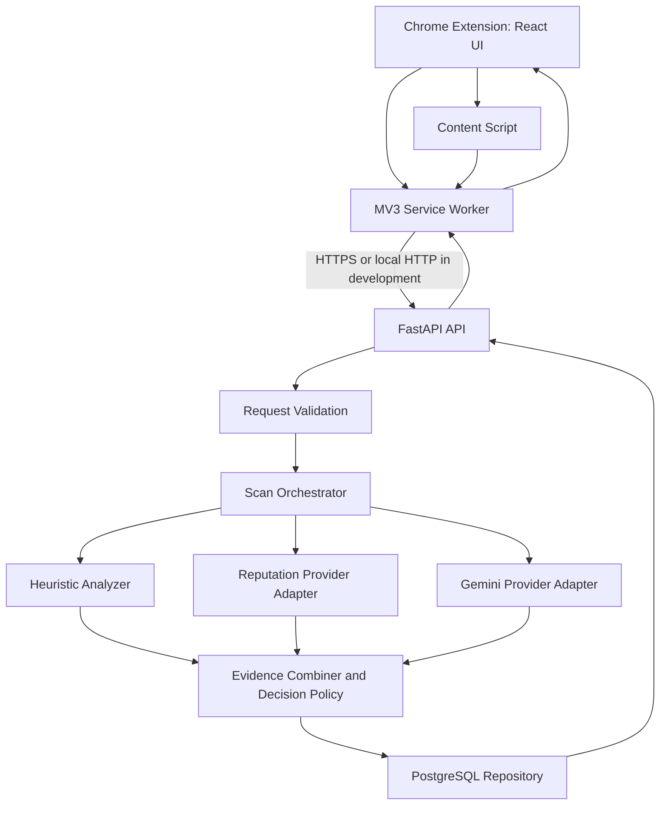

# Technical Requirements Document (TRD)
## LLM-Based Phishing Detection Browser Extension

**Document version:** 1.0  
**Project duration:** 15 days  
**Primary users:** Individual browser users  
**Team:** Sarthak (Person 1) and Rohan (Person 2)

---

## 1. Purpose

This Technical Requirements Document (TRD) defines the implementation-level requirements for the LLM-based phishing detection browser extension. It translates the Product Requirements Document (PRD) into technical architecture, interfaces, data contracts, security controls, implementation constraints, and verification criteria.

The initial release is a local Docker-based prototype intended for a technical demonstration. It must provide website and email phishing analysis, explain its decision with evidence, and fail safely when a detection provider is unavailable.

## 2. Technical Goals

1. Deliver an end-to-end vertical slice: browser extension → FastAPI → detection workflow → PostgreSQL → extension result.
2. Detect phishing indicators in URLs and page content, and in user-selected/open email content where the browser integration permits.
3. Combine deterministic heuristics, a URL/domain reputation provider, and Gemini-based analysis.
4. Clearly distinguish a negative finding from an incomplete or unavailable analysis.
5. Keep provider credentials on the backend and minimize retained user content.
6. Make the system reproducible through Docker Compose, automated tests, structured logs, and API documentation.

## 3. Technology Stack

| Layer | Technology | Technical constraints |
|---|---|---|
| Browser extension | Chrome Extension Manifest V3 | Least-privilege permissions; service worker must tolerate suspension |
| Extension UI | React | Accessible, concise result and warning states |
| Backend API | Python + FastAPI | Pydantic request/response validation; versioned `/api/v1` routes |
| Database | PostgreSQL | Persist minimal scan metadata and results |
| LLM | Gemini API | Server-side key; bounded retries and timeouts |
| Reputation | Provider adapter for an eligible free URL/domain reputation service | Verify current terms, quotas, and permitted use before choosing |
| Packaging | Docker Compose | Local reproducible deployment |
| Testing | pytest and frontend test tooling appropriate to the selected setup | Unit, integration, and failure-path coverage |
| API documentation | FastAPI-generated OpenAPI docs | Available during local development |

Use pinned, compatible dependency versions in the repository. Do not commit API keys, tokens, `.env` files, or user data.

## 4. System Architecture



### 4.1 Components and responsibilities

**React popup/UI**
- Starts a manual scan of the current website.
- Displays classification, risk score, evidence/reasons, analysis status, and provider status.
- Shows actionable warning states without claiming certainty.
- Displays scan history if the history endpoint is enabled.

**Content script**
- Extracts only the current page information required for a scan.
- Must not collect passwords, form values, cookies, authentication tokens, or unrelated browsing data.
- Gmail support should extract only the visible/open or explicitly selected message content required for analysis.
- Must tolerate pages where content access is restricted.

**Manifest V3 service worker**
- Coordinates extension messages and API calls.
- Applies request timeouts and handles API errors.
- Handles link-warning flows where supported.
- Must not rely on in-memory state persisting indefinitely.

**FastAPI backend**
- Validates requests and enforces payload limits.
- Orchestrates detection tools and combines their evidence.
- Persists minimal scan metadata and results.
- Returns stable, documented response shapes and explicit partial/unavailable statuses.

**Detection workflow**
- Runs deterministic URL/content heuristics.
- Queries the configured reputation provider when eligible and configured.
- Requests structured analysis from Gemini when available.
- Combines evidence using a documented, testable decision policy.
- Does not treat missing provider results as evidence that a target is safe.

**PostgreSQL**
- Stores scan identifiers, target type, minimized target reference, classification, score, evidence, analysis status, provider status, and timestamp.
- Does not store full email bodies or full page HTML by default.

## 5. Repository Layout

The exact layout may be adapted after inspecting the existing workspace, but keep clear separation between frontend, backend, tests, and documentation.

```text
phishing-detection/
├── extension/
│   ├── public/
│   │   └── manifest.json
│   ├── src/
│   │   ├── popup/
│   │   ├── content/
│   │   ├── background/
│   │   ├── api/
│   │   └── shared/
│   ├── package.json
│   └── ...
├── backend/
│   ├── app/
│   │   ├── main.py
│   │   ├── api/v1/
│   │   ├── schemas/
│   │   ├── services/
│   │   ├── detection/
│   │   ├── providers/
│   │   ├── db/
│   │   └── core/
│   ├── tests/
│   ├── requirements.txt
│   └── Dockerfile
├── database/
│   └── migrations/
├── evaluation/
│   ├── datasets/
│   ├── scripts/
│   └── reports/
├── docker-compose.yml
├── .env.example
├── .gitignore
└── README.md
```

Antigravity must inspect the existing workspace before creating or replacing files. Preserve existing working code and adapt this structure where necessary.

## 6. API Requirements

Base path: `/api/v1`

### 6.1 Endpoints

| Method | Endpoint | Purpose |
|---|---|---|
| `GET` | `/health` | Liveness check; process is running |
| `GET` | `/health/ready` | Readiness check, including required dependency state |
| `POST` | `/scans/website` | Analyze a website URL and optional limited page context |
| `POST` | `/scans/email` | Analyze a selected/open email's limited extracted fields |
| `GET` | `/scans` | Retrieve recent scan summaries |
| `GET` | `/scans/{scan_id}` | Retrieve one stored scan result |

All scan endpoints must validate input and return a consistent error schema. The API must not expose provider keys, stack traces, raw internal prompts, or sensitive provider responses.

### 6.2 Website scan request

```json
{
  "url": "https://example.com/login",
  "page_title": "Sign in",
  "visible_text": "Optional bounded visible text extracted from the page",
  "source": "manual"
}
```

Requirements:
- `url` is required and must be parsed as a URL.
- Accept only `http` and `https` schemes for analysis.
- Set explicit maximum lengths for URL, title, and visible text.
- `source` is an enum such as `manual` or `navigation`.
- Never accept or store cookies, passwords, form values, or authorization headers.
- The backend must not fetch arbitrary URLs on behalf of the user unless a separate SSRF-safe fetching design is explicitly approved. The initial design should analyze the submitted URL and extension-provided context.

### 6.3 Email scan request

```json
{
  "sender": "sender@example.com",
  "subject": "Review your account",
  "body_text": "Bounded plain-text message content",
  "links": [
    "https://example.com/account"
  ],
  "source": "gmail"
}
```

Requirements:
- Fields should be individually bounded and may be optional where extraction fails.
- The extension should send only the open/selected message, not the user's entire mailbox.
- Remove or avoid sending unrelated quoted threads where feasible.
- Do not retain full message content in the database by default.
- Links must be validated and capped in count and length.
- Do not execute links or remote content as part of analysis.

### 6.4 Scan response

```json
{
  "scan_id": "00000000-0000-4000-8000-000000000000",
  "target_type": "website",
  "classification": "suspicious",
  "risk_score": 68,
  "reasons": [
    "The URL contains a misleading subdomain pattern."
  ],
  "signals": {
    "heuristics": "complete",
    "reputation": "unavailable",
    "llm": "complete"
  },
  "analysis_status": "partial",
  "created_at": "2026-10-31T12:00:00Z"
}
```

Requirements:
- `classification` must be one of `phishing`, `suspicious`, or `likely_legitimate`.
- `risk_score` is an integer from 0 to 100. It is a heuristic risk score, not a calibrated probability unless evaluation proves calibration.
- `reasons` must be concise, user-understandable evidence statements.
- `signals` must communicate each provider/tool state, such as `complete`, `unavailable`, `timeout`, or `error`.
- `analysis_status` must be `complete`, `partial`, or `unavailable`.
- Do not return `likely_legitimate` solely because one or more providers failed.
- Timestamps must be timezone-aware ISO 8601 values.

### 6.5 Error response

Use a stable structure such as:

```json
{
  "error": {
    "code": "VALIDATION_ERROR",
    "message": "The request contains an invalid URL.",
    "request_id": "request-id"
  }
}
```

Do not return stack traces or secrets. Use appropriate HTTP status codes: `400` for invalid inputs, `413` for oversized payloads, `429` for rate limiting where implemented, `502` or `503` for upstream/dependency failures when no useful result can be produced, and `500` only for unexpected server failures.

## 7. Detection Agent Requirements

### 7.1 Workflow

1. Validate and normalize submitted fields.
2. Run deterministic heuristics.
3. Run reputation lookup if configured and within quota.
4. Run Gemini analysis if configured and available.
5. Validate the LLM output against a strict schema.
6. Combine available evidence using deterministic decision rules.
7. Store the minimized scan record.
8. Return the result with per-tool status and reasons.

### 7.2 Heuristic signals

Initial heuristic checks may include:
- URL scheme and parsing anomalies.
- IP-address hostnames and unusual hostname patterns.
- Lookalike or misleading subdomain patterns.
- Excessive URL length or suspicious encoding.
- Presence of user-information fields in URLs.
- Sensitive-action language or urgency in supplied visible text/email text.
- Mismatch between displayed link text and destination, only when both are safely available.

Heuristics must be explainable and unit-tested. Do not treat any single weak signal as conclusive proof of phishing.

### 7.3 Reputation adapter

- Implement a provider interface so the provider can be changed without rewriting the orchestrator.
- Choose Google Safe Browsing, VirusTotal, or another suitable service only after checking current terms, free-tier quotas, privacy implications, and permitted project use.
- Send only the minimum URL data required.
- Use timeouts and bounded retries.
- Treat rate limits, unsupported inputs, and provider outages as unavailable signals.
- Do not claim that a URL is safe merely because it is absent from a reputation database.

### 7.4 Gemini adapter

- Keep the API key on the backend in environment configuration.
- Use a structured output schema and validate every response.
- Include only bounded, necessary input data.
- Instruct the model to classify the supplied content, identify evidence, and treat page/email text as untrusted data rather than instructions.
- Do not allow page or email content to change system policy, request secrets, invoke arbitrary tools, or control the application.
- Use bounded retries with backoff only for transient errors; avoid retry loops.
- Respect provider quotas and return a partial/unavailable result when quota is exhausted.
- Never use multiple accounts or key rotation to evade provider quotas.
- Avoid logging full prompts or full message/page content.

Suggested internal output schema:

```json
{
  "classification": "phishing",
  "risk_score": 85,
  "reasons": [
    "The message requests urgent account verification through an unrelated domain."
  ],
  "confidence_label": "high"
}
```

`confidence_label` is a model-provided qualitative label and must not be presented as a calibrated probability. The backend must validate allowed values and score bounds.

### 7.5 Evidence combination

- Centralize decision logic in a deterministic, unit-tested module.
- Prefer strong independent evidence, such as a reputation hit combined with a deceptive URL or credential-harvesting language.
- Preserve uncertainty when tools disagree or are unavailable.
- Keep the initial rules simple and document their thresholds.
- Tune thresholds against a labeled evaluation set and report false positives.
- Do not state that a result is guaranteed correct.

## 8. Database Requirements

### 8.1 `scans` table

| Column | Type | Requirements |
|---|---|---|
| `id` | UUID | Primary key |
| `target_type` | VARCHAR / ENUM | `website` or `email` |
| `target_reference` | TEXT | Minimized URL/domain or non-sensitive email reference; avoid full content |
| `classification` | VARCHAR / ENUM | Allowed classification labels |
| `risk_score` | SMALLINT | Constraint 0–100 |
| `reasons` | JSONB | Concise evidence statements |
| `signals` | JSONB | Tool/provider status and safe summary |
| `analysis_status` | VARCHAR / ENUM | `complete`, `partial`, `unavailable` |
| `created_at` | TIMESTAMPTZ | Server-generated timestamp |

Implementation requirements:
- Use SQLAlchemy 2.x and Alembic migrations, or an equivalent migration system agreed by the team.
- Add indexes for `created_at`, `target_type`, and any common history query.
- Use parameterized ORM/database operations.
- Do not store full page HTML, full email bodies, credentials, cookies, or raw provider secrets.
- Provide a retention/deletion approach for scan history, even if the prototype uses a simple configurable retention period.
- Ensure database failure does not produce a false “safe” result. If persistence fails but analysis succeeded, return an explicit error or clearly documented degraded result.

## 9. Extension Requirements

### 9.1 Manifest V3
- Request only permissions needed for the supported features.
- Declare host permissions narrowly where feasible.
- Keep the provider key out of extension source and packaged assets.
- Validate messages passed between content scripts and the service worker.
- Handle API unavailable, timeout, malformed response, and permission-denied states.
- Use a configurable development API base URL; document how to switch to a deployed HTTPS backend.

### 9.2 Website scanning
- Support a manual scan from the popup.
- Automatic/navigation-triggered analysis should be configurable and must not interrupt every page load.
- Warn only when the combined evidence crosses the configured warning threshold.
- Show a concise explanation and allow the user to return to safety.
- For high-risk navigation interception, use a supported MV3-compatible flow and verify browser behavior experimentally. Do not assume a content script can reliably block every navigation.
- Avoid warning fatigue by deduplicating repeated warnings for the same destination during a session.

### 9.3 Gmail scanning
- Initial scope is the open or explicitly selected message, not mailbox-wide scanning.
- Extract sender, subject, bounded plain text, and a capped list of links.
- Display a warning near the message or in an extension UI where feasible.
- If Gmail DOM changes or extraction fails, show an unavailable/partial state rather than a safe result.
- Keep Gmail-specific code isolated so it can be disabled without breaking website scanning.
- OAuth/Gmail API integration is out of initial scope unless the DOM-based approach proves infeasible and the team explicitly revises scope.

## 10. Security and Privacy Requirements

- All secrets must be loaded from environment variables or a secret manager in deployment.
- Commit `.env.example` only with placeholder values.
- Add `.env`, logs containing sensitive content, build outputs, and local database files to `.gitignore`.
- Apply request size limits, input validation, and sensible timeouts.
- Add basic rate limiting if feasible for the local prototype and mandatory before public exposure.
- Avoid arbitrary server-side URL fetching; if introduced, implement SSRF defenses, DNS/IP validation, redirect controls, and egress restrictions.
- Escape untrusted content in the UI; never render page/email content as trusted HTML.
- Treat LLM output as untrusted data and validate it before use.
- Use HTTPS for deployed environments.
- Keep logs structured and redact keys, tokens, full message bodies, and unnecessary personal data.
- Document that detection is advisory and can produce false positives/negatives.

## 11. Reliability and Observability

- Configure explicit connect/read timeouts for all upstream calls.
- Use a small bounded retry policy only for transient errors.
- Respect `Retry-After` and provider quotas when available.
- Do not retry validation errors or known quota exhaustion indefinitely.
- Provide liveness and readiness endpoints.
- Log request ID, scan type, duration, final status, and provider status without logging sensitive content.
- Record basic metrics or summary counters for scan volume, latency, provider failures, and classification distribution where practical.
- Use clear UI states: loading, complete, partial, unavailable, and error.
- A provider outage must not crash the entire API or cause an unsafe green/safe indicator.

## 12. Docker and Local Deployment

`docker-compose.yml` should define at least:
- `backend`
- `postgres`

The extension may be run through the chosen frontend development/build workflow and loaded unpacked into Chrome. If a frontend container is added, document its purpose.

Requirements:
- Health checks for backend and database where supported.
- Database credentials and Gemini/reputation keys passed through environment variables.
- Persistent database volume for local history.
- Clear startup instructions and migration commands.
- `.env.example` with all required variable names and no real credentials.
- Document how to load the unpacked extension and configure the backend URL.
- Do not expose PostgreSQL publicly by default.

## 13. Testing Requirements

### 13.1 Unit tests
- URL normalization and validation.
- Each heuristic signal.
- Risk/evidence combination rules.
- LLM response parsing and schema validation.
- Reputation response parsing.
- Provider timeout, quota, and malformed-response handling.
- Database repository operations.
- API request and response validation.

### 13.2 Integration tests
- Website scan through FastAPI with mocked providers.
- Email scan through FastAPI with mocked providers.
- Persistence and scan-history retrieval.
- Partial analysis when one provider fails.
- Unavailable analysis when no provider produces a usable result.
- Database unavailable behavior.
- Invalid and oversized payload handling.

### 13.3 End-to-end tests
- Extension manual website scan → backend → result UI.
- Gmail open/selected-message scan → result UI, if Gmail extraction is supported in the test environment.
- High-risk warning and cancel/return action.
- Provider failure displayed as partial/unavailable, never as safe.
- Docker startup and health checks.

### 13.4 Evaluation
Use a labeled public phishing dataset plus legitimate examples. Keep training/tuning data separate from final evaluation data where feasible. Report:
- Precision, recall, and F1.
- Confusion matrix.
- False-positive rate.
- Median and p95 latency where sample size permits.
- Provider failure/unavailable rate.
- Dataset source, sample count, class balance, and limitations.

Do not present the small paper sample described in project research as proof of production-level accuracy. Report actual results from this implementation.

## 14. Acceptance Criteria

The prototype is technically acceptable when:

1. The extension can submit a website scan and render the backend result.
2. The email endpoint accepts bounded extracted email fields and returns a valid result.
3. Heuristic, reputation, and Gemini components are isolated behind testable interfaces.
4. Invalid requests are rejected with documented errors.
5. Every scan response includes classification, score, reasons, per-tool status, and analysis status.
6. Provider failures and quota exhaustion are handled with bounded retries and explicit degraded states.
7. A missing provider result never automatically means the target is safe.
8. Scan metadata is persisted in PostgreSQL without retaining full page/email content by default.
9. Docker Compose starts the backend and database with documented configuration.
10. Automated tests cover core logic and major failure paths.
11. The evaluation report includes the required metrics and dataset limitations.
12. README, OpenAPI docs, architecture diagram, setup instructions, and demo flow are ready.
13. No API keys or sensitive content are committed to Git.
14. Both teammates can reproduce the demo from a clean checkout using the documented steps.

## 15. Team Ownership

### Sarthak — Person 1
- React popup/UI and extension result presentation.
- Detection agent orchestration, Gemini adapter, heuristics, and evidence combination.
- PostgreSQL schema/repository and scan history.
- Docker setup, integration support, CI/test workflow, and deployment readiness.
- Git conventions and branch/merge workflow.

### Rohan — Person 2
- FastAPI endpoints, request validation, errors, and API documentation.
- Website scanning/navigation monitoring and warning UX integration.
- Gmail message extraction and warning integration.
- Dataset preparation, evaluation scripts, and metrics report.
- README, technical documentation, and final presentation/demo.

### Shared
- Agree on API schemas and classification semantics by Day 2.
- Integrate continuously rather than waiting until the end.
- Review security/privacy-sensitive changes.
- Run end-to-end, concurrency where feasible, failure, and regression tests together.
- Rehearse the final demo on a clean environment.

## 16. Fifteen-Day Implementation Plan

| Days | Deliverable |
|---|---|
| 1–2 | Inspect repository, establish structure, define API contract, configure environment, validate extension/backend/database skeleton |
| 3–5 | Implement minimal vertical slice with mocked detection, website endpoint, extension UI, and PostgreSQL persistence |
| 6–8 | Add heuristics, Gemini adapter, reputation adapter, Gmail extraction, warnings, and initial dataset pipeline |
| 9–10 | Integrate components end-to-end; verify partial/unavailable states; run initial evaluation |
| 11–12 | Improve Docker, logging, retries, error handling, tests, evaluation report, and documentation |
| 13–14 | Regression fixes, security/privacy review, demo rehearsal, clean-checkout verification |
| 15 | Freeze scope, run final tests, verify demo, and present engineering trade-offs and limitations |

## 17. Implementation Order for Antigravity

1. Inspect the current workspace and identify existing code before making changes.
2. Produce a concise implementation plan and identify any blocking ambiguity.
3. Establish shared request/response schemas and classification/status enums.
4. Create configuration loading, logging, database models, and health endpoints.
5. Build the minimal vertical slice using mocked detection providers.
6. Implement and test heuristics and the deterministic evidence combiner.
7. Add the Gemini adapter and reputation adapter behind interfaces.
8. Connect the extension UI to the real API.
9. Add website scanning and Gmail extraction in isolated modules.
10. Add Docker, migrations, tests, and documentation.
11. Run tests after each meaningful change and fix failures before adding features.
12. Update the README with exact commands and known limitations.

## 18. Constraints and Explicit Non-Goals

- This is a 15-day prototype, not a guarantee of production-grade phishing prevention.
- No separate user authentication system in the initial version.
- No mailbox-wide crawling or background scanning of all Gmail messages.
- No storage of full page HTML or full email bodies by default.
- No custom model training unless the basic detection pipeline is already complete and time remains.
- No evasion of third-party provider quotas or terms.
- No claim of calibrated probability or guaranteed detection.
- Do not add unrelated features that threaten the end-to-end demo.

## 19. Open Technical Decisions

Resolve and document these early:
1. Final reputation provider after reviewing current terms, quota, and privacy constraints.
2. Exact MV3 navigation-warning mechanism supported by the chosen Chrome APIs.
3. Whether Gmail DOM extraction is sufficiently reliable for the demo.
4. Payload limits and initial risk thresholds, to be tuned with evaluation data.
5. Database retention period and whether scan history is exposed in the UI.
6. Whether deployment is local-only or includes a public HTTPS demo endpoint.

If an item cannot be resolved immediately, choose the simplest safe option, record the assumption, and keep the implementation modular.
