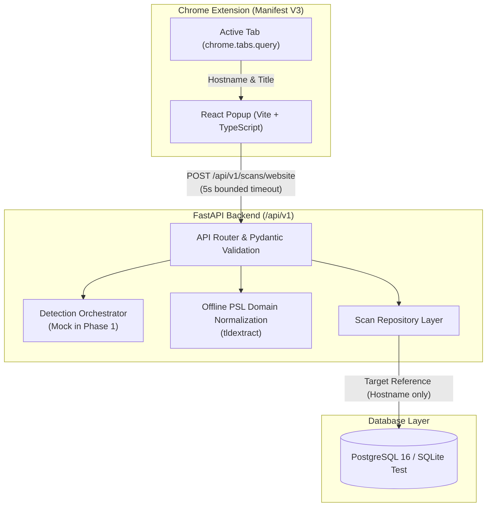

# Phishing Attack Detector

A browser-assisted phishing detection system combining a Chrome Extension (Manifest V3) frontend with a FastAPI backend, deterministic detection orchestration, and PostgreSQL persistence.

> **Status:** Phase 1 Complete (Minimal Vertical Slice & React Extension Popup MVP).
> **Detection Mode (Phase 1):** `MockDetectionOrchestrator` returning deterministic test fixtures matching the production response contract. Real heuristics, Google Safe Browsing reputation, and Gemini LLM analysis will be implemented in subsequent phases.

---

## 1. Architecture Overview



### Components
- **Chrome Extension (`extension/`):** Manifest V3 popup built with Vite, React 18, and TypeScript. Styled with the Quiet Security design tokens. Communicates exclusively with localhost backend (`http://127.0.0.1:8000`).
- **FastAPI Backend (`backend/app/`):** REST API providing versioned endpoints under `/api/v1`. Enforces strict Pydantic v2 schemas and standard error shapes (`VALIDATION_ERROR`, `NOT_FOUND`, `SERVICE_UNAVAILABLE`).
- **Domain Normalization (`backend/app/core/domain.py`):** Offline-safe public suffix extraction via bundled Public Suffix List (PSL) snapshot with zero runtime network fetching.
- **Data Privacy & Repository (`backend/app/db/`):** SQLAlchemy 2.0 models with UUID identifiers, JSONB evidence/tool statuses, and check constraints. Only normalized domains/hostnames are persisted in `target_reference`. Full URLs, query strings, auth tokens, page HTML, and email bodies are never stored.

---

## 2. API Endpoints (`/api/v1`)

| Method | Endpoint | Description | Phase 1 Status |
|---|---|---|---|
| `GET` | `/api/v1/health` | Liveness probe returning `{"status": "ok"}` | Implemented |
| `GET` | `/api/v1/health/ready` | Readiness probe checking database connectivity (`SELECT 1`) | Implemented |
| `POST` | `/api/v1/scans/website` | Scan website URL; normalizes domain and returns verdict | Implemented |
| `POST` | `/api/v1/scans/email` | Scan extracted email indicators (sender, subject, links) | Implemented |
| `GET` | `/api/v1/scans` | Paginated scan history ordered newest first (`limit`, `offset`) | Implemented |
| `GET` | `/api/v1/scans/{scan_id}` | Retrieve single stored scan result by UUID | Implemented |

---

## 3. Implemented vs. Planned Features

### Implemented (Phase 1)
- [x] Chrome Manifest V3 extension popup with Vite + React 18 + TypeScript.
- [x] Quiet Security design system (default light editorial palette: canvas `#F7F5F0`, surface `#FFFFFF`, ink `#17212B`, muted `#5F6B75`, border `#D8DEE3`, teal `#0F766E`, amber `#9A5B00`, red `#B42318`, slate `#EDF1F4`).
- [x] Active tab domain resolution and "Scan current site" user trigger.
- [x] Five distinct popup states: Idle, Scanning, Successful Result, Analysis Unavailable, and Connection/Timeout Error.
- [x] Expandable "Why this result?" progressive disclosure section with evidence details and per-tool status indicators.
- [x] 5-second request timeout handling with informative failure message.
- [x] Explicit non-probabilistic score labeling ("Risk score: X / 100 — not a probability of phishing").
- [x] Strict safety principle: provider failures or unavailable analyses never render as clean or safe.
- [x] FastAPI application with standardized 400/404/500 structured error handling.
- [x] Pydantic v2 validation enforcing URL schemes (`http`, `https`), length bounds, and source enums.
- [x] Offline Public Suffix List domain extraction preventing runtime network dependencies.
- [x] SQLAlchemy 2.0 models and Alembic migration (`001_initial_scans.py`).
- [x] Docker Compose configuration for PostgreSQL 16.
- [x] Pre-commit / pre-push secret scanner (`scripts/check_secrets.py`) with test suite.

### Planned for Future Phases
- [ ] **Phase 2:** Deterministic heuristic engine (IP hostname, punycode lookalikes, misleading subdomains, credential keywords) and server-side Gemini LLM adapter with structured JSON output.
- [ ] **Phase 2:** Chrome navigation warning interstitial and Gmail DOM open-thread extraction spike.
- [ ] **Phase 3:** Reputation provider adapter (Google Safe Browsing), deterministic evidence combiner, and 30-day retention scheduled job.
- [ ] **Phase 4:** End-to-end wiring of live detection pipeline, Gmail inline panel, and history purge (`DELETE /api/v1/scans`).
- [ ] **Phase 5:** Concurrency testing, failure-injection tests, dataset evaluation pipeline (PhishTank/Tranco), and precision/recall reporting.
- [ ] **Phase 6:** Clean demo rehearsal, regression verification, and final presentation freeze.

---

## 4. Setup and Installation

### Prerequisites
- Python 3.11+
- Node.js 18+ (verified on v24.14.1) & npm
- Docker & Docker Compose (optional for local SQLite testing, required for live PostgreSQL)

### Backend Setup

1. Create a Python virtual environment:

   ```bash
   python -m venv .venv
   ```

2. Activate the virtual environment:

   **Windows PowerShell:**
   ```powershell
   .venv\Scripts\Activate.ps1
   ```

   **Linux/macOS:**
   ```bash
   source .venv/bin/activate
   ```

3. Install dependencies:

   ```bash
   pip install -r backend/requirements.txt -r backend/requirements-dev.txt
   ```

4. Configure environment:

   ```bash
   cp .env.example .env
   ```

   **Note:** The backend exposes health checks at both `/api/v1/health` (original) and `/health` (alias for Chrome extension compatibility). Both return `{"status":"ok"}`.

5. Run the API server locally:

   ```bash
   uvicorn backend.app.main:app --host 127.0.0.1 --port 8000 --reload
   ```

   API interactive documentation will be available at `http://127.0.0.1:8000/docs`.


### Extension Setup & Build
1. Navigate to the `extension/` directory and install dependencies:
   ```bash
   cd extension
   npm install
   ```
2. Build the extension bundle:
   ```bash
   npm run build
   ```
   Production assets will be emitted into `extension/dist/`.
3. Load in Google Chrome:
   - Open Chrome and navigate to `chrome://extensions/`.
   - Enable **Developer mode** (toggle in top-right corner).
   - Click **Load unpacked** and select `C:\Phishing Attack Detector\extension\dist`.
   - The "Phishing Attack Detector" shield icon will appear in your Chrome toolbar.

---

## 5. Verification & Testing

### Backend Automated Tests
Run the offline test suite (SQLite in-memory, zero external network calls):
```bash
python -m pytest backend/tests/ -v --tb=short --ignore=backend/tests/test_postgres_integration.py
```
**Result:** 40 passed in ~1.7s.

Run secret scanner validation:
```bash
python scripts/check_secrets.py
python -m pytest scripts/test_check_secrets.py -v
```
**Result:** 7 passed; repository clean of secrets and credential leaks.

### Live PostgreSQL Integration Tests (Requires Docker)
Start the PostgreSQL container:
```bash
docker compose up -d db
```
Run database migrations:
```bash
cd backend
alembic upgrade head
cd ..
```
Run live database integration tests:
```bash
python -m pytest backend/tests/test_postgres_integration.py -v
```
**Result:** 2 passed against live PostgreSQL 16 container (`TestLivePostgresIntegration`).*(Tests automatically skip if the container is offline).*

### Extension Verification
Run type-checking and production build:
```bash
cd extension
npm run type-check
npm run build
```
**Result:** TypeScript compilation clean (`tsc --noEmit`), Vite production build clean (`dist/` generated).

---

## 6. Privacy & Security Safeguards

1. **Target Minimization:** The database only stores normalized domains/hostnames (e.g., `paypal-security-check.phish-alert.com`). Full URLs containing query strings, session tokens, or personal identifiers are stripped prior to persistence.
2. **No Content Logging:** Full webpage HTML, visible text excerpts, and email message bodies are never persisted in PostgreSQL or written to application logs.
3. **Strict CORS Policy:** Wildcard origins (`*` or `chrome-extension://*`) are forbidden. CORS is strictly restricted to explicit localhost origins and configured extension IDs.
4. **Server-Side Credentials:** All third-party API keys (e.g., Gemini, Google Safe Browsing) are managed exclusively server-side via environment variables and never bundled into frontend extension code.
5. **No Safe-by-Default on Failure:** If external providers or backend services timeout or return errors, the system outputs an explicit `unavailable` or `partial` state, never claiming the target is legitimate.

---

## 7. Current Limitations

- **Phase 1 Mock Detection:** The detection orchestrator currently returns deterministic fixture results (`MockDetectionOrchestrator`) based on keywords in submitted URLs (`phish`, `suspicious`, `unavailable`). Real heuristics and ML/LLM analysis are scheduled for Phase 2.
- **Manual Chrome Testing Required:** End-to-end extension popup behavior in Chrome requires loading the unpacked `extension/dist` folder in `chrome://extensions/` and manually clicking the extension on active tabs.
- **Docker Dependency for Postgres:** Local development testing uses in-memory SQLite by default; persistent PostgreSQL testing requires running Docker Compose.
