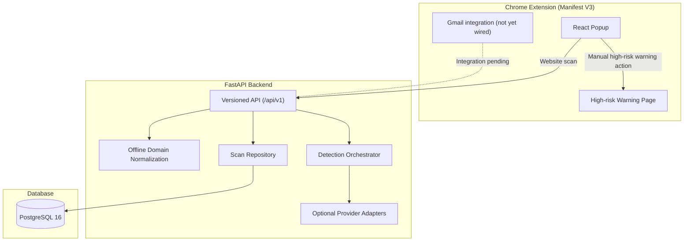

# Phishing Attack Detector

A browser-assisted phishing detection system built with a Chrome
Manifest V3 extension, a FastAPI backend, deterministic phishing
heuristics, optional external analysis providers, and PostgreSQL
persistence.

> **Current status:** Core website scanning, deterministic detection,
> scan history, optional provider adapters, and the manual high-risk
> warning flow are implemented. Gmail extraction and automatic
> navigation interception are not yet integrated into the production
> extension.

## 1. Architecture



### Main components

-   **Chrome extension (`extension/`):** Manifest V3 extension built
    with React, TypeScript, and Vite. Includes the popup, backend status
    indicator, scan results, scan history, and a high-risk warning page.
-   **FastAPI backend (`backend/app/`):** Versioned API with Pydantic
    validation, structured errors, detection orchestration, and
    scan-history operations.
-   **Detection engine:** Deterministic heuristics evaluate URL and
    available content indicators. Risk scores are indicators, not
    probabilities.
-   **Optional providers:** Gemini analysis is opt-in. Google Safe
    Browsing live requests remain disabled until explicitly configured
    and approved.
-   **Persistence:** SQLAlchemy models and Alembic migrations store scan
    records using normalized host/domain references rather than full
    submitted URLs.

## 2. API endpoints

The following endpoints are implemented according to the current project
audit.

| Method | Endpoint | Description |
|--------|----------|-------------|
| GET | /api/v1/health | Backend liveness check |
| GET | /api/v1/health/ready | Readiness check, including database connectivity |
| POST | /api/v1/scans/website | Analyze a website URL |
| POST | /api/v1/scans/email | Analyze supplied email indicators |
| GET | /api/v1/scans | Retrieve paginated scan history |
| GET | /api/v1/scans/{scan_id} | Retrieve one scan by ID |
| DELETE | /api/v1/scans | Clear scan history |
| GET | /health | Health-check alias for extension compatibility |


## 3. Implemented capabilities and remaining work

### Implemented

-   [x] Chrome Manifest V3 popup built with React, TypeScript, and Vite.
-   [x] Quiet Security visual design and distinct idle, scanning,
    result, unavailable, and error states.
-   [x] Website scanning API and deterministic URL/content heuristics.
-   [x] Evidence combination and bounded 0--100 risk scoring.
-   [x] Explicit `complete`, `partial`, and `unavailable` analysis
    states; provider failures are not treated as safe results.
-   [x] Optional server-side Gemini adapter with explicit opt-in and
    structured-response validation.
-   [x] Google Safe Browsing adapter, with live requests gated and
    disabled by default pending explicit approval.
-   [x] Scan-history retrieval, clearing, and 30-day retention cleanup.
-   [x] Background retention scheduler integrated with FastAPI lifespan.
-   [x] Manual high-risk warning page launched from a scan result.
-   [x] PostgreSQL 16 Docker Compose configuration and Alembic migration
    workflow.
-   [x] Verification includes backend automated tests, extension type-checking and production-build checks, plus secret-scanning checks.

### Remaining work

-   [ ] Integrate Gmail open-message extraction into the production
    extension and add the inline result/warning UI. The existing
    extraction spike is not yet wired into the live extension.
-   [ ] Implement and verify automatic navigation interception. The
    current warning page is a manual post-scan flow; it does not
    intercept every navigation or block background requests.
-   [ ] Build a reproducible public-dataset evaluation pipeline and
    report measured precision, recall, F1, false-positive rate,
    confusion matrix, and latency.
-   [ ] Complete end-to-end regression testing and the final demo
    walkthrough.

## 4. Setup and installation

### Prerequisites

-   Python 3.11 or later
-   Node.js 18 or later and npm
-   Docker and Docker Compose for PostgreSQL-backed development and
    integration tests

### Backend setup

From the repository root:

1.  Create a virtual environment:

    ```bash
    python -m venv .venv
    ```

2.  Activate it.

    **Windows PowerShell:**

    ```powershell
    .venv\Scripts\Activate.ps1
    ```

    **Linux/macOS:**

    ```bash
    source .venv/bin/activate
    ```

3.  Install dependencies:

    ```bash
    pip install -r backend/requirements.txt -r backend/requirements-dev.txt
    ```

4.  Create your local environment file:

    ```powershell
    # Windows PowerShell
    Copy-Item .env.example .env
    ```

    ```bash
    # Linux/macOS
    cp .env.example .env
    ```


    Configure only the values needed for the features you intend to run.
    Keep credentials in the backend environment; never place provider
    keys in the extension.

5.  Start the API:

    ```bash
    uvicorn backend.app.main:app --host 127.0.0.1 --port 8000 --reload
    ```

    Interactive API documentation: `http://127.0.0.1:8000/docs`.

### PostgreSQL setup

Start the database service:

```bash
docker compose up -d db
```

Apply migrations from the repository root:

```powershell
cd backend
alembic upgrade head
cd ..
```

### Extension setup

From the repository root:

```bash
cd extension
npm install
npm run build
```

The production bundle is generated in `extension/dist/`.

To load it in Chrome:

1.  Open `chrome://extensions/`.
2.  Enable **Developer mode**.
3.  Select **Load unpacked**.
4.  Choose the `extension/dist/` directory.

## 5. Verification and tests

Run the backend test suite:

```bash
python -m pytest backend/tests/ -v --tb=short
```

Run extension checks and build:

```bash
cd extension
npm run type-check
npm run build
```

Run the secret scanner and its tests:

```bash
python scripts/check_secrets.py
python -m pytest scripts/test_check_secrets.py -v
```

PostgreSQL integration tests require the database container to be
running. Test counts and outcomes can change as the project evolves; use
the output from your current local test run rather than relying on
historical counts in this README.

To run PostgreSQL integration tests, start the database container first:

```bash
docker compose up -d db
```

Then run:

```bash
python -m pytest backend/tests/test_postgres_integration.py -v
```

If the PostgreSQL host is unreachable, all tests in that file are
automatically skipped with an explanatory message.

## 6. Security & Privacy

### CORS & security

-   Wildcard origins (`*`) are prohibited.
-   Only explicitly configured origins are allowed. When the Chrome
    extension requires backend access, its exact origin
    (`chrome-extension://<extension-id>`) must be added to
    `ALLOWED_ORIGINS` in the backend configuration. The wildcard pattern
    `chrome-extension://*` is prohibited.
-   Credentials and API keys remain on the backend; they are never exposed
    to the extension or client side.

### Privacy guarantees

-   **Data minimisation:** Scan history stores only normalized host/domain
    references, not full submitted URLs.
-   **No persistence of sensitive data:** Query strings, session tokens,
    full page content, and email bodies are not persisted by default.
-   **Logging hygiene:** Logs must not contain full content, credentials, or
    sensitive URL parameters.

### Gemini integration

-   Gemini analysis is optional and requires explicit per-scan user opt‑in through the `opt_in_gemini` request field.
-   When opt‑in is disabled, no Gemini requests are made.
-   Gemini credentials are stored only in the backend environment and are
    never bundled with the extension.
-   Provider errors, timeouts, or unavailability result in a `partial`
    or `unavailable` analysis state; they must never cause a safe
    classification.

### Google Safe Browsing integration

-   The Safe Browsing adapter exists but live requests are disabled by
    default.
-   Enabling live Safe Browsing requests or configuring an API key requires
    explicit project‑owner approval.
-   If the provider is unavailable, the analysis must fall back to a
    `partial` or `unavailable` state, not a safe verdict.

## 7. Known limitations

-   **Navigation protection:** The extension currently provides a manual
    post-scan high-risk warning flow. Automatic pre-navigation
    interception, omnibox interception, and comprehensive blocking of
    background network requests are not implemented.
-   **Gmail integration:** The backend email-scan endpoint exists, and
    an extraction spike has been developed, but Gmail extraction and
    inline results are not yet integrated into the production extension.
-   **Evaluation:** Public-dataset evaluation and measured
    model/detector performance metrics have not yet been completed.
-   **Database mode:** SQLite is used in selected tests;
    PostgreSQL-backed development and integration testing require Docker
    Compose.
